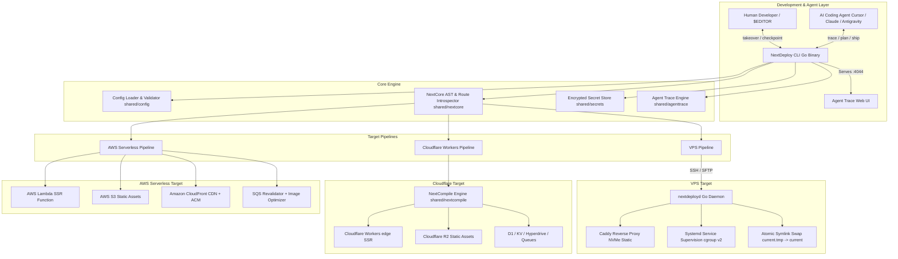

# NextDeploy Architecture & Technical Blueprint

NextDeploy is an open-source, multi-target deployment engine and agent continuity platform designed specifically for modern Next.js applications (Next.js 14, 15, and 16 with Turbopack or Webpack).

It enables developers and autonomous AI coding agents to package, provision, deploy, trace, and monitor Next.js applications across bare-metal Linux VPS, Cloudflare Workers, and AWS Serverless from a single configuration file (`nextdeploy.yml`) and unified CLI.

---

## 1. System Topology & Architecture



---

## 2. Core Subsystems

### A. CLI & Command Engine (`cli/`)
Built with Go and Cobra, the CLI provides idempotent commands with dual-mode output (ANSI-colored human output or structured machine JSON for CI/CD and AI agents):
- `init`: Interactively scaffold or detect Next.js framework configuration.
- `plan`: Terraform-style preflight calculation showing resource drift, missing secrets, and route changes without applying. Supports `--detailed-exitcode` for CI/CD gates.
- `build`: Invokes target-aware compilation (`next build` for VPS/Lambda; `nextcompile` with webpack shims for Cloudflare Workers).
- `ship` (alias `deploy`): Executes build, static chunk pooling, compute provisioning, health probing, and atomic cutover in one step.
- `rollback`: Reverts production traffic to previous active version in under 1 second without rebuilding.
- `trace`: Built-in agent trace subsystem (`checkpoint`, `status`, `takeover`, `ui`, `resume`).
- `takeover` (direct alias): 20-line Developer Takeover Brief + `-o` to launch touched files directly in `$EDITOR`.
- `secrets`: Local ChaCha20-Poly1305 / AES-256 encrypted secret management, Doppler, and AWS Secrets Manager integration.

---

### B. Next.js Static Introspection Engine (`shared/nextcore/`)
Rather than treating Next.js as a generic Node.js container, NextDeploy parses the `.next` compilation output before moving any bytes:
- **Route Classification**: Parses `.next/server/pages-manifest.json`, `app-paths-manifest.json`, and route manifests to classify every route as `static`, `SSR`, `ISR`, `Server Action`, or `API`.
- **Integration Detection**: Analyzes compiled client and server chunks to automatically detect external integrations (Stripe, Cloudinary, Google Analytics, Prisma, Supabase) and warn if corresponding secrets are missing.
- **ISR & Cache Awareness**: Extracts revalidation times (`revalidate: 60`) to wire selective CDN invalidation.
- **Git Provenance**: Statically embeds commit hash, author, branch, dirty flag, and build timestamp into deployment metadata (`metadata.json`).

---

### C. Universal Next.js Compiler for Edge (`shared/nextcompile/`)
Running full Next.js 14/15/16 App Router on Cloudflare Workers requires shimming Node.js built-ins and bridging worker requests to Next.js internals:
- **`nextserver` Engine**: Custom pure-Go runtime compiler bundling the standalone server, virtual file system (VFS) shims, and `workerd` compatibility flags (`nodejs_compat_v2`).
- **Asset Separation**: Automatically strips `.next/static/` and `public/` assets from the worker bundle, pushing them directly to Cloudflare R2 with immutable 1-year cache headers (`Cache-Control: public, max-age=31536000, immutable`).
- **Resource Binding Orchestration**: Automatically reconciles D1 SQL databases, KV namespaces, Hyperdrive connection pools, Queues, and Vectorize indexes declared in `nextdeploy.yml`.

---

### D. VPS Bare-Metal Engine (`daemon/` & Caddy)
For developers deploying to $4/month Linux VPS instances (Hetzner, DigitalOcean, OVH):
- **`nextdeployd` Go Daemon**: Static Go binary running under systemd with `DynamicUser=yes`, `ProtectSystem=strict`, and `PrivateTmp=yes`. Communicates with the CLI over SSH or mTLS Unix domain sockets.
- **Zero Docker Daemon Overhead**: Runs directly on bare metal, isolated using Linux kernel `cgroup v2` memory limits (`MemoryMax=1G`).
- **True Zero-Downtime Atomic Cutover**: Dual-stage verification (TCP listener probing + HTTP `GET /api/health`), followed by atomic POSIX directory symlink replacement (`current.tmp` ➔ `current`).
- **Cumulative Static Chunk Pooling (`shared_static`)**: Permanently eliminates Next.js `ChunkLoadError` 404s for active user sessions across updates by retaining previous hashed chunks.

---

### E. AWS Serverless Target Engine (`cli/internal/serverless/`)
For enterprise compliance and serverless autoscaling on AWS:
- **Compute**: Deploys Next.js standalone server onto AWS Lambda (`nodejs20.x`) with custom streaming HTTP bridge.
- **Edge Routing**: Amazon CloudFront distribution with Origin Access Control (OAC), automated ACM SSL certificate issuance, and custom DNS validation.
- **Cold-Start Secret Injection**: Leverages AWS Secrets Manager Lambda Extension to fetch secrets into memory cache at cold start, avoiding unencrypted environment variables.
- **ISR & Revalidation**: SQS queue and dedicated revalidation Lambda for non-blocking on-demand cache revalidation.

---

### F. Agent Trace Subsystem (`shared/agenttrace/`)
Native context continuity and observability layer for AI coding agents:
- **Trace Storage**: Maintained in `.nextdeploy/trace/` (`checkpoint.json`, `events.json`, `takeover.md`), interoperable with `.handoff/`.
- **Embedded Web UI (`:4044`)**: Real-time HTTP dashboard embedded in the Go binary displaying active agent session, model, modified files, diff viewer, and live deployment cards.
- **Human Takeover Protocol**: `nextdeploy takeover -o` reads the scannable 20-line brief and launches touched files straight into Neovim / VS Code / Cursor.

---

### G. Frontend Web App (`frontend/`)
The official user-facing documentation and marketing web application:
- Built with **Next.js 16 (Turbopack)**, **React 19**, and **Tailwind CSS v4**.
- Custom markdown loader (`lib/docs-loader.ts`) parsing 56+ documentation files with frontmatter and GitHub-flavored markdown.
- Fully prerendered as static HTML/JSON with 0 server-side bottlenecks.

---

## 3. Directory Layout

```
NextDeploy/
├── cli/                         # Cobra CLI commands and target runners
│   ├── cmd/                     # CLI commands (ship, plan, trace, secrets, etc.)
│   └── internal/                # Buildflow, CI/CD generator, DNS, and serverless logic
├── daemon/                      # nextdeployd — Linux VPS daemon (Go)
├── shared/                      # Core packages shared between CLI and daemon
│   ├── agenttrace/              # Agent Trace engine, storage, and port 4044 Web UI
│   ├── config/                  # nextdeploy.yml loader, schema, and validation
│   ├── nextcompile/             # Cloudflare Workers runtime compiler & VFS shims
│   ├── nextcore/                # Next.js AST, route, and integration introspector
│   ├── nextbuild/               # Next.js build orchestrator & Turbopack detect
│   ├── secrets/                 # ChaCha20-Poly1305 encryption & secret providers
│   ├── health/                  # TCP and HTTP health probing sentinel
│   └── caddy/                   # Caddyfile generator & reverse-proxy configuration
├── frontend/                    # Next.js 16 (Turbopack) frontend web app & docs
│   ├── app/                     # App router pages, docs, login, and dashboard
│   ├── components/              # Radix UI and Tailwind v4 component library
│   ├── content/docs/            # Markdown documentation pages (56+ guides)
│   └── lib/                     # Docs loader, navigation config, and utilities
├── docs/                        # VitePress static documentation site
├── magefile.go                  # Mage build targets for local development & release
└── sample.nextdeploy.yml        # Reference annotated configuration
```
