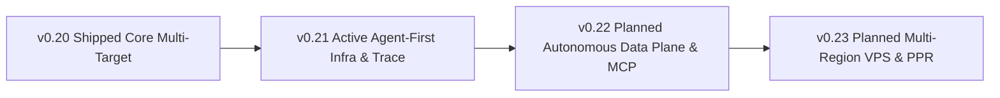

# NextDeploy Engineering Roadmap & TODOs

This document tracks active engineering milestones, planned enhancements, and technical debt across the NextDeploy monorepo (Go CLI, `nextdeployd` daemon, `nextcompile` edge runtime, and Next.js frontend).

---

## 1. Milestone Overview & Status

| Milestone | Focus | Status | Target |
| :--- | :--- | :--- | :--- |
| **v0.20.x** | Core Engine: VPS, Cloudflare Workers, AWS Serverless, Next.js 16 Turbopack | **SHIPPED** | Production |
| **v0.21.x** | Agent-First Infra: Native Agent Trace, Takeover Brief, Port 4044 Local Web UI | **IN ACTIVE DEV** | Q4 2026 |
| **v0.22.x** | Native MCP Server, Ephemeral Preview Sandboxes, Autonomous Data Plane | **PLANNED** | Q1 2027 |
| **v0.23.x** | Multi-Region VPS Clusters, Cloudflare Partial Prerendering (PPR), `"use cache"` | **PLANNED** | Q2 2027 |

---

## 2. Agent-First Infrastructure & Continuity (P0)

Transform NextDeploy into the premier execution runtime for AI coding agents (Antigravity IDE, Claude Code, Cursor, Windsurf, Kiro).

- [x] **Native Agent Trace Engine (`shared/agenttrace`)**:
  - [x] Schema models for checkpoints (`checkpoint.json`), lifecycle events (`events.json`), and takeover briefs (`takeover.md`).
  - [x] Automatic session detection in `nextdeploy ship` and pre-flight intent logging.
  - [x] Automatic failure and success event capture across VPS and Cloudflare targets.
- [x] **CLI Takeover Suite (`cli/cmd/trace.go`)**:
  - [x] `nextdeploy takeover` and `nextdeploy takeover -o` (launches `$EDITOR` on modified files).
  - [x] `nextdeploy trace checkpoint` with intent, agent, and model tracking.
  - [x] `nextdeploy trace status` and `nextdeploy trace resume --agent <name>`.
- [x] **Embedded Web UI on Port 4044 (`shared/agenttrace/webui.go`)**:
  - [x] Embedded single-page dashboard with real-time session status, modified files diff viewer, and deployment cards.
  - [x] REST endpoints: `/api/status`, `/api/diff`.
- [x] **Native Model Context Protocol (MCP) Server (`cli/cmd/mcp.go`)**:
  - [x] Implement `nextdeploy mcp` stdio JSON-RPC 2.0 server.
  - [x] Expose tools: `nextdeploy_inspect`, `nextdeploy_plan`, `nextdeploy_ship`, `nextdeploy_status`, `nextdeploy_trace`, `nextdeploy_takeover`, `nextdeploy_rollback`.
  - [x] Auto-scaffold MCP server configuration for Cursor, Claude Desktop, and Antigravity IDE (`nextdeploy mcp init`).
- [ ] **Structured Agent Diagnostics (`--format=agent-json`)**:
  - [ ] Parse Next.js 14/15/16 prerender and dynamic server usage errors into structured `{ file, line, error_code, fix_hint }` envelopes.
  - [ ] Non-interactive automated error triage for autonomous agent loops.
- [ ] **Autonomous Data Plane Binding**:
  - [ ] Add `nextdeploy db bind [d1 | postgres | sqlite | neon]`.
  - [ ] Auto-provision database instances and inject encrypted connection strings without human console intervention.

---

## 3. Cloudflare Workers Target (`shared/nextcompile`) (P1)

Next-generation edge compilation and resource orchestration for Cloudflare Workers.

- [x] **Next.js 16 Turbopack & Webpack Parity**:
  - [x] Custom `nextserver` pure-Go compiler running `NextNodeServer` inside `workerd`.
  - [x] Build-time VFS shims and streaming HTTP bridge (`Suspense` / React 19 RSC).
  - [x] Static asset offloading to Cloudflare R2 with immutable 1-year cache headers.
- [x] **Resource Binding Declarations in YAML**:
  - [x] Declarative D1 SQL, Hyperdrive connection pooling, R2 buckets, Queues, KV, and Durable Objects.
- [ ] **Next.js 16 Partial Prerendering (PPR)**:
  - [ ] Support hybrid static shell + dynamic streaming RSC on Cloudflare Workers.
- [ ] **Remote Cache Handler (`"use cache"`)**:
  - [ ] Implement `@next/cache-handlers` specification backed by R2 (large objects) and KV (metadata/tags).
- [ ] **Multi-Worker Micro-Routing**:
  - [ ] Option to split heavy background queues or isolated API routes into dedicated satellite workers.
- [ ] **Automated Ephemeral PR Preview Teardown**:
  - [ ] Add `nextdeploy cleanup --expired-previews` to purge old preview workers and orphaned R2 folders.

---

## 4. Bare-Metal Linux VPS & Daemon (`nextdeployd`) (P1)

High-performance, container-less deployment on bare-metal servers.

- [x] **Zero-Downtime Atomic Cutover**:
  - [x] Dual-stage TCP listener probing and HTTP GET `/api/health` verification.
  - [x] Atomic POSIX symlink replacement (`current.tmp` ➔ `current`).
  - [x] 5-release ring buffer with sub-second rollbacks (`nextdeploy rollback`).
- [x] **Cumulative Static Chunk Pooling (`shared_static`)**:
  - [x] Preserves historical content-hashed JS chunks to eliminate client-side `ChunkLoadError` 404s.
- [x] **Caddy & systemd Hardening**:
  - [x] Automated Let's Encrypt TLS issuance and direct NVMe byte delivery.
  - [x] `DynamicUser=yes`, `ProtectSystem=strict`, and `cgroup v2` memory capping (`MemoryMax=1G`).
- [ ] **Multi-Server VPS Clustering**:
  - [ ] Deploy across multiple heterogeneous VPS nodes (e.g. 3 Hetzner nodes) with rolling cutovers.
  - [ ] Centralized health arbitration and traffic draining.
- [ ] **Mesh Networking via WireGuard**:
  - [ ] Optional WireGuard tunnel between local developer machine / CI/CD and VPS daemon, eliminating the need for public SSH ports.
- [ ] **Daemon Observability & Metrics**:
  - [ ] Add native Prometheus metrics endpoint (`http://localhost:9100/metrics`) to `nextdeployd`.
  - [ ] Track CPU, memory consumption per application release, and request latency histograms.

---

## 5. AWS Serverless Target (P2)

Enterprise-grade serverless autoscaling on AWS.

- [x] **Lambda Standalone Packaging**:
  - [x] Minimal bundle extraction (`output: standalone`) keeping packages under 35MB.
  - [x] Default ARM64 Graviton architecture.
- [x] **CloudFront Edge Distribution & OAC**:
  - [x] 4 edge routing cache behaviors (`/_next/static/*`, `/static/*`, `/_next/image*`, default `*`).
  - [x] Automated ACM SSL certificate issuance and DNS validation.
- [x] **Asynchronous Decoupled ISR**:
  - [x] SQS revalidation queue with Dead-Letter Queue (DLQ) support and CloudFront path invalidation.
- [ ] **Lambda Provisioned Concurrency Auto-Tuning**:
  - [ ] Optional auto-scaling schedule for provisioned concurrency during high-traffic business hours.
- [ ] **Automated S3 Lifecycle Cleanup**:
  - [ ] S3 lifecycle rules to expire pruned release tarballs and orphaned static assets after 90 days.
- [ ] **CloudFront KeyValueStore Integration**:
  - [ ] Sub-millisecond edge redirects and maintenance mode switches at CloudFront edge without invoking Lambda.

---

## 6. Secrets & Security Engine (`shared/secrets`) (P1)

- [x] **Authenticated Encryption (AEAD)**:
  - [x] ChaCha20-Poly1305 and AES-256-GCM authenticated encryption with Argon2id key derivation.
  - [x] Local encrypted binary vault format (`.secrets`).
  - [x] Key rotation via `nextdeploy secrets rotate`.
- [x] **Cloud Provider Integrations**:
  - [x] Doppler dynamic secret synchronization.
  - [x] AWS Secrets Manager Lambda Extension in-memory caching.
  - [x] Cloudflare Worker encrypted secret variables.
- [ ] **1Password CLI Integration**:
  - [ ] Direct secret resolution from 1Password vaults (`op://vault/item/field`).
- [ ] **Automated Secret Leak Detection**:
  - [ ] Pre-commit and pre-ship scanner to prevent accidental plaintexts in `nextdeploy.yml` or repo code.

---

## 7. Developer Experience, Tooling & Frontend Web App (P2)

- [x] **Next.js 16 Frontend Web App (`frontend/`)**:
  - [x] Next.js 16 Turbopack marketing and documentation platform with React 19 and Tailwind CSS v4.
  - [x] Custom markdown docs loader parsing 65+ comprehensive technical guides.
- [x] **CLI Developer Experience**:
  - [x] `nextdeploy init` interactive wizard with automatic target detection.
  - [x] `nextdeploy plan --detailed-exitcode` for CI/CD gates.
  - [x] `nextdeploy generate-ci` for GitHub Actions and GitLab CI.
  - [x] `nextdeploy update` for GitHub Releases binary self-updates.
- [ ] **Interactive TUI Dashboard**:
  - [ ] Terminal dashboard (`nextdeploy tui`) built with Bubble Tea for live server and deployment monitoring.
- [ ] **Webhook Notifications**:
  - [ ] Webhook triggers (Slack, Discord, PagerDuty, custom webhook) on deployment success, probe failure, or rollback.
- [ ] **Offline Documentation Search**:
  - [ ] Pagefind / Algolia static search indexing integrated into `frontend/` documentation.
