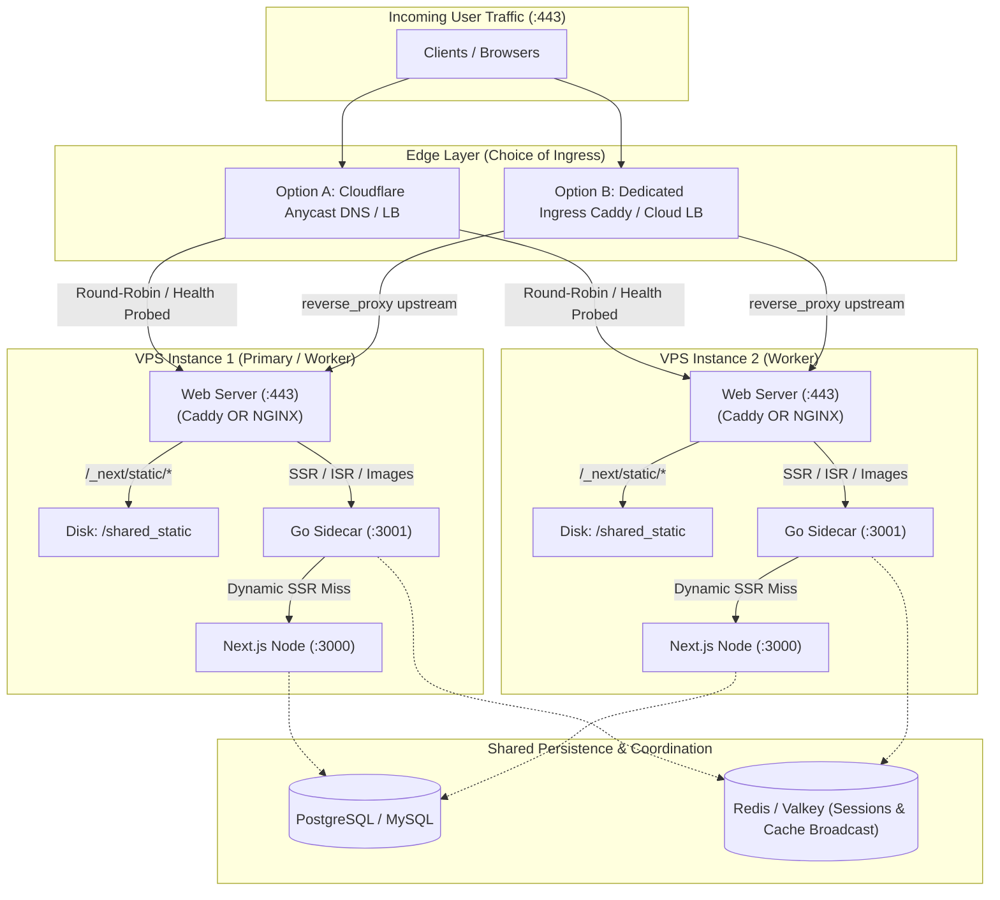
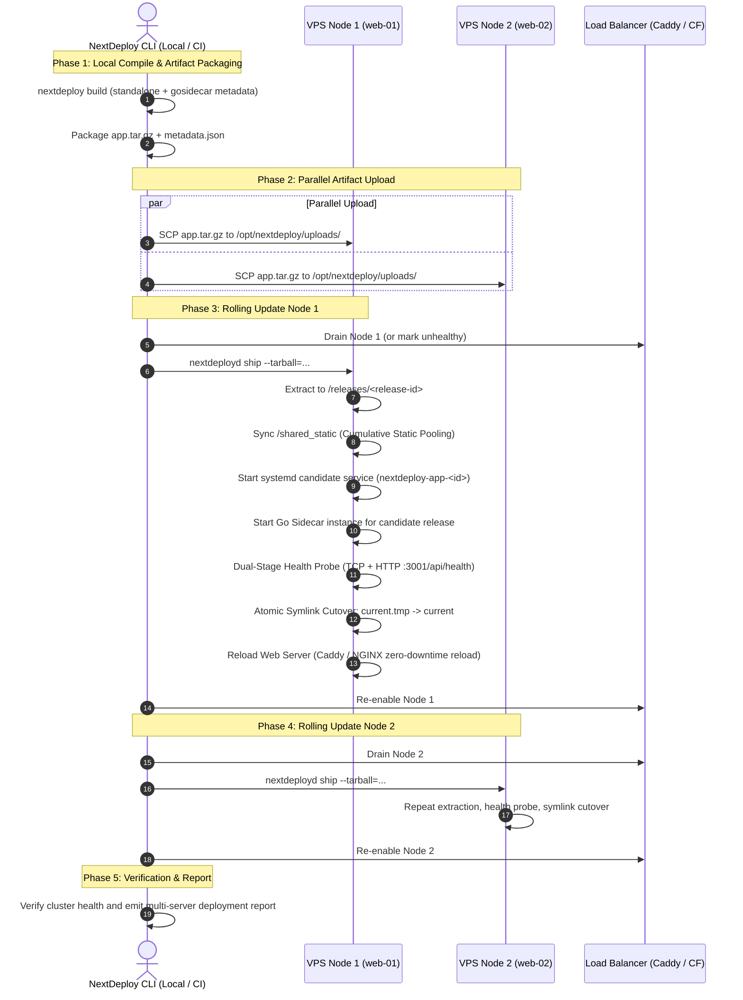
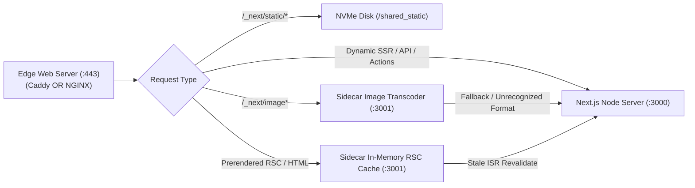

# NextDeploy VPS Multi-Server Deployment, Load Balancing & Go Sidecar Architecture Plan

## Executive Summary

This plan defines the end-to-end architecture and implementation strategy for scaling Next.js applications on Virtual Private Servers (VPS) using NextDeploy. It addresses four interconnected requirements:
1. **Multi-Server Orchestration**: Fleet management across $N$ servers with parallel artifact staging and zero-downtime rolling cutovers.
2. **Load Balancing & Traffic Distribution**: Layer 4/Layer 7 routing strategies (Edge Caddy upstream pooling, Cloudflare Anycast Round-Robin, and cloud load balancers) with active health probing.
3. **Go Sidecar (`gosidecar`) Integration**: Running in-memory RSC Flight caching, ISR revalidation, and native concurrent WebP/AVIF image transcoding ahead of Node.js on every server instance.
4. **Enterprise Web Server Option (NGINX + Caddy Certs)**: An ultra-high-throughput tier leveraging NGINX as the primary reverse proxy and static engine (`sendfile`, `epoll`, connection pooling) paired with Caddy exclusively as an automated zero-touch ACME certificate lifecycle manager.

---

## 1. Multi-Server & Load Balancing Topology

NextDeploy supports three primary traffic-distribution topologies for VPS clusters:



### Ingress & Load Balancing Models

| Ingress Strategy | Mechanism | SSL Termination | Health Checking | Best For |
| :--- | :--- | :--- | :--- | :--- |
| **Option A: Cloudflare Anycast DNS** | Multiple `A`/`AAAA` records per domain or Cloudflare Load Balancing pool | Cloudflare Edge + Origin TLS | Cloudflare Edge active probes to `/api/health` | Multi-region, zero extra hardware costs, global DDoS defense |
| **Option B: Dedicated Edge Caddy** | Standalone $4 VPS running Caddy with `reverse_proxy` to upstream VPS IPs | Edge Caddy (Let's Encrypt / ZeroSSL) | Active HTTP health probing (`interval 5s`, `timeout 2s`) | Private VPC networks, internal cluster routing |
| **Option C: Cloud Provider LB** | Hetzner / DigitalOcean / AWS ALB/NLB | Cloud Provider Managed SSL | TCP / HTTP `/api/health` target groups | Strict SLA, cloud-native automated IP failover |

---

## 2. Configuration Schema (`nextdeploy.yml`)

The multi-server configuration extends `sample.nextdeploy.yml` with multi-node definitions, load-balancing parameters, and web server selection:

```yaml
version: "1.0"
target_type: vps

app:
  name: store-fleet
  domain: store.example.com
  port: 3000
  environment: production
  
  # Go Sidecar Configuration (Deployed to every server)
  gosidecar:
    enabled: true
    port: 3001
    image_optimization: true
    max_image_workers: 4
    isr_cache: true
    revalidation_broadcast: redis # redis | webhook | local

# Web Server Engine Selection: "caddy" (default) or "nginx"
web_server:
  type: nginx # caddy | nginx
  ssl_provider: caddy # caddy automates ACME certs for NGINX
  worker_processes: auto
  worker_connections: 16384
  sendfile: true
  tcp_nopush: true
  tcp_nodelay: true
  gzip: true
  brotli: true

# Multi-Server Fleet Specification
servers:
  - name: web-01
    host: 198.51.100.10
    port: 22
    username: ubuntu
    key_path: ~/.ssh/id_ed25519
    role: worker # worker | ingress | all_in_one
    tags: [zone-a, nvme]

  - name: web-02
    host: 198.51.100.11
    port: 22
    username: ubuntu
    key_path: ~/.ssh/id_ed25519
    role: worker
    tags: [zone-b, nvme]

# Load Balancing & Healthchecks
load_balancer:
  strategy: round_robin # round_robin | least_conn | ip_hash | cookie
  sticky_sessions:
    enabled: false
    cookie_name: nd_session
  healthcheck:
    path: /api/health
    interval: 5s
    timeout: 2s
    healthy_threshold: 2
    unhealthy_threshold: 3

# Rolling Update Deployment Policy
deployment:
  policy: rolling # rolling | parallel | canary
  batch_size: 1   # deploy 1 node at a time (or 50%)
  drain_timeout: 15s
  auto_rollback: true
```

---

## 3. Deployment Orchestration & Zero-Downtime Rolling Updates

When shipping to multiple servers, NextDeploy uses a **staged rolling cutover** rather than updating all instances simultaneously.



### Safety Invariants During Rolling Updates
1. **Cumulative Static Chunk Pooling (`shared_static`)**:
   - Each VPS node maintains `/var/www/apps/<app>/shared_static`.
   - On release cutover, new JavaScript/CSS chunks are copied into `shared_static` while retaining chunks from the previous 10 releases.
   - If a client connected to Node 2 holds HTML referencing an asset from release $N-1$, Node 2 continues serving those chunks without returning `ChunkLoadError` 404s.
2. **Dual-Stage Health Probing**:
   - The Go agent probes both the Node.js server (`:3000`) and the Go Sidecar (`:3001`) before the web server route is reloaded.
   - If candidate probing fails within the configured timeout (e.g. 15s), the candidate service is terminated, the release is rolled back locally, and the CLI aborts the deployment to subsequent nodes.

---

## 4. Go Sidecar (`gosidecar`) on Multi-Server VPS

The Go Sidecar sits between the edge web server (Caddy or NGINX) and the Next.js standalone server on each VPS instance:



### Key Responsibilities
1. **Prerendered RSC Flight Serving**:
   - Parses the Next.js `prerender-manifest.json` and client reference manifests upon release startup.
   - Serves `.rsc` Flight payloads and static `.html` shells straight from an in-memory memory map (`mmap`) or high-speed LRU buffer.
2. **Native WebP / AVIF Image Transcoding**:
   - Intercepts `/_next/image?url=...&w=...&q=...`.
   - Executes image scaling and format conversions using compiled Go image libraries (libvips/bimg or pure Go image decoders) bounded by `max_image_workers: 4` to prevent memory contention.
3. **Multi-Node Revalidation Synchronization**:
   - In a multi-server setup, when an on-demand revalidation (`revalidatePath` or `revalidateTag`) occurs on Server 1, Server 2's sidecar must also invalidate its local cache.
   - **Resolution**: NextDeploy supports a pub/sub cache broadcast via Redis/Valkey (`PUBSUB nextdeploy:revalidate`) or lightweight cluster webhook pings over the private network.

---

## 5. Enterprise High-Performance Web Tier: NGINX + Caddy Cert Agent

For enterprise environments handling heavy traffic (10,000+ req/s per node), NextDeploy supports running **NGINX as the high-speed data plane** while retaining **Caddy exclusively as a background control plane for automated zero-touch ACME certificates**.

```mermaid
flowchart TD
    subgraph Public["Public Internet"]
        Client["Client Request"]
    end

    subgraph Ports["Public Ports"]
        Port80["Port :80 (HTTP)"]
        Port443["Port :443 (HTTPS)"]
    end

    subgraph NginxEngine["NGINX High-Performance Engine (C / epoll)"]
        NginxMaster["NGINX Master Process"]
        NginxWorker["NGINX Worker Processes (sendfile, zero-copy)"]
        ACMECheck{"URI: /.well-known/acme-challenge/*"}
        StaticCheck{"URI: /_next/static/* OR /public/*"}
    end

    subgraph CaddyCertAgent["Caddy Cert Agent (Local Daemon)"]
        CaddyACME["Caddy ACME Engine (:2015)"]
        CertStore[("Disk: /etc/ssl/caddy/certificates")]
    end

    subgraph BackendNodes["Local Backend Pipeline"]
        Sidecar["Go Sidecar (:3001)"]
        NodeJS["Next.js Node (:3000)"]
        SharedStatic["Disk: /shared_static"]
    end

    Client --> Port80
    Client --> Port443
    Port80 --> NginxWorker
    Port443 --> NginxWorker

    NginxWorker --> ACMECheck
    ACMECheck -->|Yes: ACME Challenge| CaddyACME
    ACMECheck -->|No| StaticCheck

    StaticCheck -->|Yes: Static Assets| SharedStatic
    StaticCheck -->|No: SSR / Images / RSC| Sidecar
    Sidecar -->|SSR Cache Miss| NodeJS

    CaddyACME -->|Auto-Renew (Let's Encrypt / ZeroSSL)| CertStore
    CertStore -.->|ssl_certificate / ssl_certificate_key| NginxWorker
    CaddyACME -.->|systemctl reload nginx on renewal| NginxMaster
```

### Why Enterprise Organizations Choose This Hybrid
1. **Raw Throughput & Deterministic Latency**:
   - NGINX is written in C and executes on the Linux `epoll` asynchronous event-driven loop with dedicated multi-worker processes pinned to CPU cores.
   - Utilizes direct kernel zero-copy data streaming (`sendfile`, `tcp_nopush`, and `tcp_nodelay`), serving static assets and proxying buffered streams with minimal CPU and memory overhead.
2. **Compliance & Corporate Tooling**:
   - Enterprise security teams often mandate NGINX for custom WAF integrations (ModSecurity, Coraza), custom log formatters for Datadog/Splunk, and pre-existing corporate hardening standards.
3. **Zero-Maintenance Automated Certificates**:
   - Traditional NGINX deployments require fragile `certbot` cron jobs that frequently fail on renew hooks or rate limits.
   - Caddy's Go ACME engine (`certmagic`) provides robust retry logic with exponential backoff, dual-CA fallback (Let's Encrypt ➔ ZeroSSL), automated OCSP stapling, and multi-domain management.

---

### Configuration & Automated Wiring

#### Step 1: NGINX Server Block (`/etc/nginx/sites-available/<app>.conf`)
Generated automatically by `nextdeployd` during `nextdeploy prepare`:

```nginx
# Upstream connection pool to Go Sidecar
upstream gosidecar_backend {
    server 127.0.0.1:3001;
    keepalive 64; # Connection reuse for sub-millisecond latency
}

# HTTP to HTTPS redirect + ACME challenge pass-through
server {
    listen 80;
    listen [::]:80;
    server_name store.example.com;

    # Pass Let's Encrypt / ZeroSSL verification to Caddy ACME daemon
    location /.well-known/acme-challenge/ {
        proxy_pass http://127.0.0.1:2015;
        proxy_set_header Host $host;
        proxy_set_header X-Real-IP $remote_addr;
    }

    location / {
        return 301 https://$host$request_uri;
    }
}

# Main HTTPS Server
server {
    listen 443 ssl http2;
    listen [::]:443 ssl http2;
    server_name store.example.com;

    # Automated certificates managed by Caddy
    ssl_certificate /var/lib/caddy/certificates/acme-v02.api.letsencrypt.org-directory/store.example.com/store.example.com.crt;
    ssl_certificate_key /var/lib/caddy/certificates/acme-v02.api.letsencrypt.org-directory/store.example.com/store.example.com.key;

    # Modern TLS Security
    ssl_protocols TLSv1.2 TLSv1.3;
    ssl_ciphers ECDHE-ECDSA-AES128-GCM-SHA256:ECDHE-RSA-AES128-GCM-SHA256:ECDHE-ECDSA-AES256-GCM-SHA384:ECDHE-RSA-AES256-GCM-SHA384;
    ssl_prefer_server_ciphers off;
    ssl_session_cache shared:SSL:10m;
    ssl_session_timeout 1d;
    ssl_session_tickets off;

    # High-Performance Kernel Zero-Copy
    sendfile on;
    tcp_nopush on;
    tcp_nodelay on;

    # 1. Cumulative Static Chunks (Direct from NVMe Disk)
    location /_next/static/ {
        alias /var/www/apps/store-fleet/shared_static/;
        expires 1y;
        add_header Cache-Control "public, max-age=31536000, immutable";
        access_log off;
    }

    # 2. Public Static Assets (Favicon, robots, images)
    location /public/ {
        alias /opt/nextdeploy/apps/store-fleet/current/public/;
        expires 7d;
        add_header Cache-Control "public, max-age=604800";
        access_log off;
    }

    # 3. Health Probing Endpoint
    location = /api/health {
        proxy_pass http://gosidecar_backend/api/health;
        proxy_http_version 1.1;
        proxy_set_header Connection "";
        access_log off;
    }

    # 4. Next.js SSR, ISR, and Go Sidecar Image Optimization
    location / {
        proxy_pass http://gosidecar_backend;
        proxy_http_version 1.1;
        
        # Essential HTTP Headers
        proxy_set_header Upgrade $http_upgrade;
        proxy_set_header Connection $connection_upgrade;
        proxy_set_header Host $host;
        proxy_set_header X-Real-IP $remote_addr;
        proxy_set_header X-Forwarded-For $proxy_add_x_forwarded_for;
        proxy_set_header X-Forwarded-Proto $scheme;

        # Disable proxy buffering for Next.js 15/16 progressive RSC streaming
        proxy_buffering off;
        proxy_read_timeout 60s;
        proxy_send_timeout 60s;
    }
}
```

#### Step 2: Caddy ACME Cert-Agent Configuration (`/etc/caddy/Caddyfile.acme`)
Caddy is configured strictly as an ACME client listening on local port `2015`:

```caddyfile
{
    # Global ACME settings
    email ops@example.com
    admin off
    auto_https disable_redirects
}

# Bind only to loopback for ACME challenge responses forwarded by NGINX
http://127.0.0.1:2015 {
    root * /var/www/acme-challenges
    file_server
}

# Declared domain triggers Caddy's automated certificate issuance & storage
store.example.com {
    tls {
        issuer letsencrypt
        issuer zerossl
    }
    # Dummy responder — NGINX terminates public traffic
    respond "NextDeploy Caddy ACME Engine" 200
}
```

#### Step 3: Zero-Downtime NGINX Reload Hook
To reload NGINX automatically when Caddy issues or renews a certificate, NextDeploy provisions a systemd path unit (`/etc/systemd/system/caddy-cert-reload.path`):

```ini
[Unit]
Description=Watch Caddy Certificates for NGINX Reload
After=network.target

[Path]
PathModified=/var/lib/caddy/certificates
Unit=caddy-cert-reload.service

[Install]
WantedBy=multi-user.target
```

With matching service unit (`/etc/systemd/system/caddy-cert-reload.service`):

```ini
[Unit]
Description=Reload NGINX on Certificate Renewal

[Service]
Type=oneshot
ExecStart=/usr/bin/systemctl reload nginx
```

When Caddy renews the certificate ~30 days before expiration:
1. Caddy writes the new `.crt` and `.key` to `/var/lib/caddy/certificates/`.
2. Linux `inotify` triggers the systemd path unit.
3. Systemd issues `systemctl reload nginx`.
4. NGINX spawns fresh workers with the new certificate, cleanly draining existing connections without a single dropped packet.

---

## 6. Implementation Roadmap & Milestones

### Phase 1: Multi-Server CLI Orchestration (`cli/cmd/ship.go`)
- [ ] Add `--all` and `--servers=web-01,web-02` flags to `nextdeploy ship`.
- [ ] Implement `RollingDeploymentManager` in `cli/internal/server`:
  - Sequential loop over target server slice.
  - Health check polling between node transitions.
  - Clean abort and rollback trigger if a node fails cutover.

### Phase 2: Ingress Caddy Load Balancing Generator
- [ ] Add multi-upstream template generator to `caddy.GenerateCaddyfile`.
- [ ] Support generating Cloudflare DNS Round-Robin records via `nextdeploy apply` when `provider: cloudflare` is declared alongside VPS targets.

### Phase 3: Go Sidecar Multi-Node Cache Sync
- [ ] Add optional Redis pub/sub listener in `daemon/internal/daemon/sidecar_isr.go`.
- [ ] When Node.js calls revalidation, publish `{ "path": "/products", "timestamp": ... }`.
- [ ] Peer sidecars receive the message and evict the corresponding entries from their local memory cache.

### Phase 4: Enterprise NGINX + Caddy Cert Agent Generator
- [ ] Add `nginx.GenerateConfig` in `daemon/internal/daemon/nginx_manager.go`.
- [ ] Add `prepare` support for installing NGINX (`apt-get install -y nginx`) and configuring `caddy-acme.service`.
- [ ] Wire the systemd certificate reload watcher (`caddy-cert-reload.path`).

---

## 7. Verification & Operational Runbooks

### Cluster Smoke Verification
```bash
# 1. Prepare all fleet VPS nodes (provisions NGINX + Caddy cert agent if configured)
nextdeploy prepare --all

# 2. Dry-run plan and configuration verification
nextdeploy inspect --all

# 3. Ship rolling update across cluster
nextdeploy ship --all --verify

# 4. Check status across all instances
nextdeploy status --all
```

### Instant Rollback
```bash
# Rolls back all servers to the prior healthy release symlink and reloads NGINX / Caddy
nextdeploy rollback --all
```
