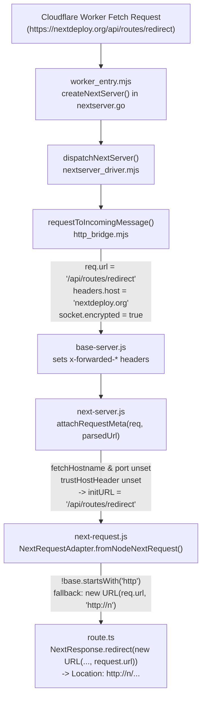

# Fixing the `http://n` Redirect & Origin Bug on Cloudflare Workers

A self-contained engineering guide to understanding why `NextRequest.url` resolves to `http://n/...` inside NextDeploy's `nextserver` Cloudflare Worker engine, the internals involved, and how to fix, test, rebuild, and verify it yourself.

---

## 1. Symptom & Impact

When hitting a Route Handler that constructs a URL relative to `request.url` on Cloudflare Workers:

```http
GET https://nextdeploy.org/api/routes/redirect
```

the Worker responds with Next.js's internal dummy origin `http://n`:

```http
HTTP/2 307
location: http://n/api/routes/methods?redirected=1
```

instead of:

```http
HTTP/2 307
location: https://nextdeploy.org/api/routes/methods?redirected=1
```

### What else this affects

- Any App Router Route Handler or Middleware reading `request.url` or `request.nextUrl.origin`
- Any `NextResponse.redirect(new URL("/path", request.url))`
- Pages Router serverless `res.revalidate()` (see `api-resolver.js` line 221, which also gates on `context.trustHostHeader`)
- Next.js internals that read `initURL` from request metadata (for example, Server Actions origin checks)

---

## 2. Visual Request Flow



---

## 3. Exact Root-Cause Walkthrough

Follow these five steps in the codebase to trace the bug from entry to output:

### Step 1: The Route Handler resolves against `request.url`

In [`frontend/app/api/routes/redirect/route.ts`](../../frontend/app/api/routes/redirect/route.ts) (lines 5–10):

```ts
export async function GET(request: NextRequest) {
  return NextResponse.redirect(
    new URL("/api/routes/methods?redirected=1", request.url),
    307,
  );
}
```

Whatever origin `request.url` has becomes the origin in the `Location` response header.

### Step 2: The Fetch-to-Node bridge creates a Node `IncomingMessage`

In [`shared/nextcompile/runtime_src/nextserver/http_bridge.mjs`](../../shared/nextcompile/runtime_src/nextserver/http_bridge.mjs) (`requestToIncomingMessage`, lines 17–89):

- The incoming Fetch `Request` has `request.url === "https://nextdeploy.org/api/routes/redirect"`.
- Line 67 sets `req.url = pathWithQuery` (`"/api/routes/redirect"`). Keeping `req.url` relative is **intentional and correct** — Node's `IncomingMessage.url` is expected to be path + query, and Next.js's router matches against a relative URL.
- Lines 35–38 ensure `headers.host = url.host` (`"nextdeploy.org"`), and line 75 sets `req.socket.encrypted = url.protocol === "https:"` (`true`).

### Step 3: `BaseServer` sets `x-forwarded-*` and attaches request metadata

In `frontend/node_modules/next/dist/server/base-server.js` (lines 597–607):

- Reads `x-forwarded-proto` or `originalRequest.socket.encrypted` to detect HTTPS.
- Populates `req.headers['x-forwarded-host']`, `req.headers['x-forwarded-port']`, `req.headers['x-forwarded-proto']`, and `req.headers['x-forwarded-for']` if missing (`??=`).
- Calls `this.attachRequestMeta(req, parsedUrl)`.

### Step 4: `NextNodeServer.attachRequestMeta()` computes `initURL`

In `frontend/node_modules/next/dist/server/next-server.js` (lines 1299–1315):

```js
attachRequestMeta(req, parsedUrl, isUpgradeReq) {
    const protocol = (req.headers['x-forwarded-proto']?.includes('https')) ? 'https' : 'http';
    const initUrl = this.fetchHostname && this.port
        ? `${protocol}://${this.fetchHostname}:${this.port}${req.url}`
        : this.nextConfig.experimental.trustHostHeader
            ? `https://${req.headers.host || 'localhost'}${req.url}`
            : req.url;
    addRequestMeta(req, 'initURL', initUrl);
    addRequestMeta(req, 'initQuery', { ...parsedUrl.query });
    addRequestMeta(req, 'initProtocol', protocol);
    ...
}
```

Look at how [`shared/nextcompile/nextserver.go`](../../shared/nextcompile/nextserver.go) (lines 355–374) constructs `NextNodeServer`:

```js
return new NextNodeServer({
  dir: "/",
  dev: false,
  conf: {
    ...nextConfig,
    distDir: distDir || ".next",
    cacheHandler: undefined,
    cacheMaxMemorySize: 0,
  },
  customServer: false,
  minimalMode: false,
});
```

Evaluate the 3-way ternary in `attachRequestMeta`:

1. `this.fetchHostname && this.port` → **false** (not passed, which makes sense in Workers since a single Worker can serve custom domains and `*.workers.dev`).
2. `this.nextConfig.experimental.trustHostHeader` → **false** (not configured in `conf.experimental`).
3. **Fallback branch** → `initUrl = req.url` (relative `"/api/routes/redirect"`).

`addRequestMeta(req, 'initURL', initUrl)` stores this relative string on `req[Symbol.for('NextInternalRequestMeta')]` (see `frontend/node_modules/next/dist/server/request-meta.js`, lines 35–48).

### Step 5: `NextRequestAdapter` falls back to `'http://n'`

When Next.js constructs the Web `NextRequest` passed into `GET(request)` in `frontend/node_modules/next/dist/server/web/spec-extension/adapters/next-request.js` (lines 78–100):

```js
let url;
if (request.url.startsWith('http')) {
    url = new URL(request.url);
} else {
    // Grab the full URL from the request metadata.
    const base = getRequestMeta(request, 'initURL');
    if (!base || !base.startsWith('http')) {
        // Because the URL construction relies on the fact that the URL provided
        // is absolute, we need to provide a base URL. We can't use the request
        // URL because it's relative, so we use a dummy URL instead.
        url = new URL(request.url, 'http://n');
    } else {
        url = new URL(request.url, base);
    }
}
```

Because `initURL` was `"/api/routes/redirect"` (does not start with `'http'`), Next.js falls back to `'http://n'`, turning `request.url` into `"http://n/api/routes/redirect"`.

---

## 4. Why the Naive Fix Fails (The Overwrite Trap)

> **Warning:** If you set `req[Symbol.for("NextInternalRequestMeta")] = { initURL: request.url }` inside [`http_bridge.mjs`](../../shared/nextcompile/runtime_src/nextserver/http_bridge.mjs), **it will NOT fix the bug**.

`requestToIncomingMessage()` runs *before* `NextNodeServer` handles the request. Afterwards, `base-server.js` (line 607) calls `this.attachRequestMeta(req, parsedUrl)`, and `next-server.js` (line 1305) **unconditionally overwrites** `initURL` with the result of that 3-way ternary.

---

## 5. Core Knowledge You Need to Know

### Web Fetch API vs. Node.js `http.IncomingMessage`
- **Web Fetch `Request.url`** is always an absolute URL string (e.g. `"https://nextdeploy.org/api/routes/redirect"`).
- **Node `IncomingMessage.url`** is normally only the request-target path + query (e.g. `"/api/routes/redirect"`), while the authority/host lives in `req.headers.host` and TLS state lives on `req.socket.encrypted` or `x-forwarded-*` headers.
- Next.js's `NextNodeServer` bridges from Node `IncomingMessage` back to Web `NextRequest` inside `NextRequestAdapter.fromNodeNextRequest()`.

### `NextInternalRequestMeta` and `Symbol.for()`
- In `request-meta.js` (line 35), Next.js uses `const NEXT_REQUEST_META = Symbol.for('NextInternalRequestMeta')`.
- `Symbol.for(key)` looks up a **process/isolate-global Symbol registry**, rather than creating a unique `Symbol()`. That lets separately compiled/bundled Next.js chunks (like route modules and `next-server.js`) read and write metadata (`initURL`, `initProtocol`, `initQuery`, etc.) on the same `req` object across module boundaries without polluting enumerable HTTP fields.

### `experimental.trustHostHeader` and Host Header Security
- A bare Node HTTP server exposed directly to untrusted clients should **not** blindly trust an arbitrary `Host` header to build absolute URLs (which can enable host-header injection or cache poisoning). That is why Next.js defaults to requiring explicit `hostname` + `port` or `experimental.trustHostHeader: true`.
- On edge/serverless platforms where requests arrive through a trusted platform router/proxy (Cloudflare Workers, Vercel), the `Host` header and `request.url` represent the real routed domain, so `trustHostHeader: true` is the intended setting.
- Note that `api-resolver.js` (lines 198–225) also checks `context.trustHostHeader` when revalidating in serverless mode.

### Forwarded Headers (`Host`, `X-Forwarded-Proto`, `X-Forwarded-Host`, `X-Forwarded-Port`)
- `base-server.js` (lines 598–604) fills in missing `x-forwarded-*` headers from `req.headers.host` and `originalRequest.socket.encrypted`.
- In `http_bridge.mjs`, `req.socket.encrypted` is already set from `url.protocol === "https:"`, and `headers.host` falls back to `url.host`. Defaulting `x-forwarded-proto` and `x-forwarded-host` cleanly in the bridge guarantees consistent headers before Next.js inspects them.

### Go `//go:embed` & NextDeploy's `nextcompile` Pipeline
- Look at [`shared/nextcompile/runtime.go`](../../shared/nextcompile/runtime.go) (lines 22–23):
  ```go
  //go:embed all:runtime_src
  var embeddedRuntime embed.FS
  ```
- Both the Go template in [`shared/nextcompile/nextserver.go`](../../shared/nextcompile/nextserver.go) and the JavaScript runtime under `shared/nextcompile/runtime_src/` are **compiled directly into the `nextdeploy` Go binary**.
- Editing `.mjs` or `.go` files in `shared/nextcompile/` has **zero effect** on `nextdeploy ship` until you rebuild the Go binary (`go build -o ./bin/nextdeploy ./cli`) and use that rebuilt binary.

---

## 6. Step-by-Step Guide to Implementing the Fix

### Option A — Minimal, Idiomatic Next.js Fix (Recommended Starting Point)

Edit [`shared/nextcompile/nextserver.go`](../../shared/nextcompile/nextserver.go) inside `createNextServer()` (lines 355–374) so `conf.experimental` enables `trustHostHeader: true`:

```js
async function createNextServer() {
  const mod = await import("next/dist/server/next-server.js");
  const NextNodeServer = mod.default?.default || mod.default || mod;
  return new NextNodeServer({
    dir: "/",
    dev: false,
    conf: {
      ...nextConfig,
      experimental: {
        ...(nextConfig.experimental || {}),
        trustHostHeader: true,
      },
      distDir: distDir || ".next",
      cacheHandler: undefined,
      cacheMaxMemorySize: 0,
    },
    customServer: false,
    minimalMode: false,
  });
}
```

**Why this works:**
- It activates branch 2 of `next-server.js:1304`:
  ```js
  `https://${req.headers.host || 'localhost'}${req.url}`
  ```
- `initURL` starts with `"https://"`, so `NextRequestAdapter.fromNodeNextRequest()` builds `new URL(request.url, initURL)` with the real `Host` (e.g. `https://nextdeploy.org/api/routes/redirect`).
- Bonus: `api-resolver.js:221` also recognizes `trustHostHeader: true`.

**One quirk to be aware of:**
- Branch 2 in `next-server.js:1304` hardcodes `https://`. That is ideal for production Cloudflare Workers (`https://nextdeploy.org`, `*.workers.dev`), though under local plain-HTTP `wrangler dev` (`http://localhost:8787`) `request.url` will report `https://localhost:8787/...`.

---

### Option B — Exact `http://` vs `https://` Preservation (Optional Follow-up)

If you also want local `http://localhost:8787` dev requests to preserve `http://` instead of hardcoded `https://`:

1. Keep `experimental.trustHostHeader: true` in [`shared/nextcompile/nextserver.go`](../../shared/nextcompile/nextserver.go) (lines 358–373).
2. In [`shared/nextcompile/runtime_src/nextserver/http_bridge.mjs`](../../shared/nextcompile/runtime_src/nextserver/http_bridge.mjs) (around lines 35–38), default `x-forwarded-proto` (`url.protocol.replace(/:$/, "")`) and `x-forwarded-host` (`url.host`) on `headers` and `rawHeaders` when not already present on `request.headers`.
3. In [`shared/nextcompile/runtime_src/nextserver/nextserver_driver.mjs`](../../shared/nextcompile/runtime_src/nextserver/nextserver_driver.mjs) (`getOrCreateRequestHandler`, lines 180–188), after creating `server`, wrap `server.attachRequestMeta` so that after calling the original method, it updates `initURL` on `req[Symbol.for("NextInternalRequestMeta")]` to `${protocol}://${host}${req.url}` using the resolved `initProtocol` (`x-forwarded-proto`) rather than hardcoded `https://`.

---

## 7. Testing, Rebuilding & Live Verification

### 1. Add regression tests

- **Go test ([`shared/nextcompile/nextserver_test.go`](../../shared/nextcompile/nextserver_test.go), lines 94–101):**
  Assert that the emitted `worker_entry.mjs` contains `trustHostHeader: true`.
- **JS test ([`shared/nextcompile/runtime_src/nextserver/nextserver.test.mjs`](../../shared/nextcompile/runtime_src/nextserver/nextserver.test.mjs)):**
  If you implement Option B, assert that `x-forwarded-proto` / `x-forwarded-host` defaults are set in `requestToIncomingMessage` and that incoming proxy headers are preserved if already present.

### 2. Run unit & smoke tests

```bash
# JS runtime tests (HTTP bridge + driver)
node --test shared/nextcompile/runtime_src/nextserver/nextserver.test.mjs

# Go compiler tests
go test -v ./shared/nextcompile/...
```

Optional real standalone bundle smoke test:

```bash
NEXTDEPLOY_CF_ENGINE=nextserver \
NEXTDEPLOY_TEST_STANDALONE="$PWD/frontend/.next/standalone" \
go test -v ./cli/internal/serverless/cloudflare/adapter -run TestBuildWorkerBundle_RealStandaloneSmoke
```

### 3. Rebuild the Go CLI binary

Because `runtime_src/` and `nextserver.go` are embedded via `//go:embed`, rebuild before deploying:

```bash
go build -o ./bin/nextdeploy ./cli
```

If you run global `nextdeploy` from your `PATH`, update it too:

```bash
cp ./bin/nextdeploy /opt/homebrew/bin/nextdeploy
```

### 4. Re-ship `frontend/` and verify live

```bash
cd frontend && doppler run -- ../bin/nextdeploy ship
```

Then test the redirect endpoint:

```bash
curl -sS -I https://nextdeploy.org/api/routes/redirect
```

Expected response headers:

```http
HTTP/2 307
location: https://nextdeploy.org/api/routes/methods?redirected=1
```

---

## 8. Reference Links

### Workspace Source Files
- Route handler reproducing the bug: [`frontend/app/api/routes/redirect/route.ts`](../../frontend/app/api/routes/redirect/route.ts)
- NextServer Worker entrypoint generator (`createNextServer`): [`shared/nextcompile/nextserver.go`](../../shared/nextcompile/nextserver.go)
- NextServer Go tests: [`shared/nextcompile/nextserver_test.go`](../../shared/nextcompile/nextserver_test.go)
- Embedded runtime loader (`//go:embed`): [`shared/nextcompile/runtime.go`](../../shared/nextcompile/runtime.go)
- Fetch-to-Node HTTP bridge (`requestToIncomingMessage`): [`shared/nextcompile/runtime_src/nextserver/http_bridge.mjs`](../../shared/nextcompile/runtime_src/nextserver/http_bridge.mjs)
- Worker request driver (`getOrCreateRequestHandler`): [`shared/nextcompile/runtime_src/nextserver/nextserver_driver.mjs`](../../shared/nextcompile/runtime_src/nextserver/nextserver_driver.mjs)
- NextServer JS unit tests: [`shared/nextcompile/runtime_src/nextserver/nextserver.test.mjs`](../../shared/nextcompile/runtime_src/nextserver/nextserver.test.mjs)
- Engine architecture doc: [`docs/internals/nextserver-cloudflare-engine.md`](./nextserver-cloudflare-engine.md)
- Next.js 16 Turbopack Worker notes: [`docs/running-nextjs-16-turbopack-on-cloudflare-workers.md`](../running-nextjs-16-turbopack-on-cloudflare-workers.md)

### Local `node_modules` Inspection Paths
> Generated locally after installing `frontend` dependencies (`bun install` / `npm install`):
- `frontend/node_modules/next/dist/server/next-server.js` (lines 1299–1315 — `attachRequestMeta`)
- `frontend/node_modules/next/dist/server/base-server.js` (lines 597–607 — `x-forwarded-*` setup + `attachRequestMeta` call)
- `frontend/node_modules/next/dist/server/request-meta.js` (lines 35–48 — `Symbol.for('NextInternalRequestMeta')`)
- `frontend/node_modules/next/dist/server/web/spec-extension/adapters/next-request.js` (lines 78–100 — `http://n` fallback)
- `frontend/node_modules/next/dist/server/api-utils/node/api-resolver.js` (lines 198–235 — `trustHostHeader` in serverless revalidation)

### External Official Docs & Source Code
- **Next.js Source (GitHub):**
  - [`next-server.ts`](https://github.com/vercel/next.js/blob/canary/packages/next/src/server/next-server.ts)
  - [`base-server.ts`](https://github.com/vercel/next.js/blob/canary/packages/next/src/server/base-server.ts)
  - [`request-meta.ts`](https://github.com/vercel/next.js/blob/canary/packages/next/src/server/request-meta.ts)
  - [`next-request.ts`](https://github.com/vercel/next.js/blob/canary/packages/next/src/server/web/spec-extension/adapters/next-request.ts)
- **Next.js Documentation:**
  - [`NextRequest` API Reference](https://nextjs.org/docs/app/api-reference/functions/next-request)
  - [`NextResponse.redirect()` API Reference](https://nextjs.org/docs/app/api-reference/functions/next-response#redirect)
- **Web, HTTP, Node, Cloudflare & Go References:**
  - [MDN: `Request.url`](https://developer.mozilla.org/en-US/docs/Web/API/Request/url)
  - [MDN: `URL()` constructor](https://developer.mozilla.org/en-US/docs/Web/API/URL/URL)
  - [MDN: `Symbol.for()`](https://developer.mozilla.org/en-US/docs/Web/JavaScript/Reference/Global_Objects/Symbol/for)
  - [MDN: `Host` header](https://developer.mozilla.org/en-US/docs/Web/HTTP/Reference/Headers/Host)
  - [MDN: `X-Forwarded-Proto`](https://developer.mozilla.org/en-US/docs/Web/HTTP/Reference/Headers/X-Forwarded-Proto)
  - [MDN: `X-Forwarded-Host`](https://developer.mozilla.org/en-US/docs/Web/HTTP/Reference/Headers/X-Forwarded-Host)
  - [Node.js: `http.IncomingMessage`](https://nodejs.org/api/http.html#class-httpincomingmessage)
  - [Cloudflare Workers: Fetch Handler](https://developers.cloudflare.com/workers/runtime-apis/handlers/fetch/)
  - [Cloudflare Workers: Node.js Compatibility (`nodejs_compat`)](https://developers.cloudflare.com/workers/runtime-apis/nodejs/)
  - [Go `embed` Package](https://pkg.go.dev/embed)
