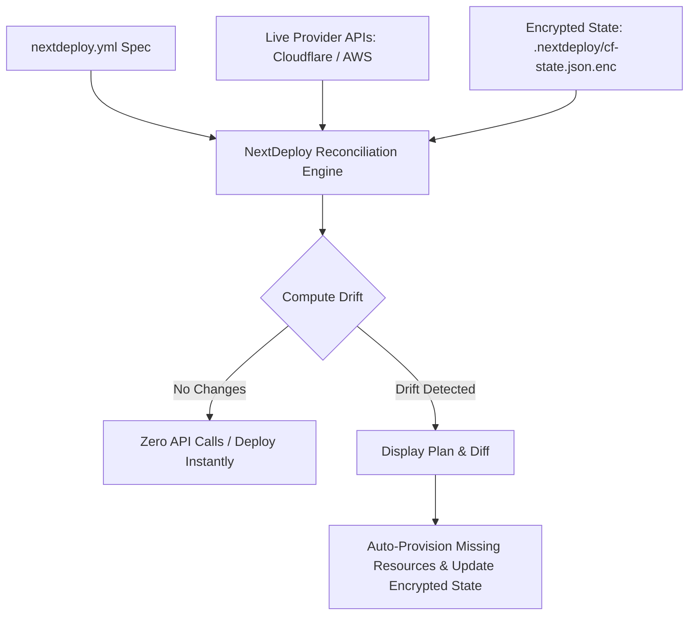

## Declarative Infrastructure Without Terraform Complexity

Traditional serverless deployments require either hundreds of lines of HashiCorp HCL (Terraform/OpenTofu) or proprietary cloud YAML stacks (Serverless Framework, SST).

NextDeploy takes a **declarative, zero-external-tool approach**:
1. You declare the cloud resources your Next.js application needs directly inside `nextdeploy.yml`.
2. NextDeploy queries live provider APIs (Cloudflare API or AWS SDK) via its Go engine.
3. NextDeploy computes a strict infrastructure diff (`CREATE`, `UPDATE`, `NOOP`, `DELETE`).
4. Upon confirmation (or automatically in CI/CD with `nextdeploy ship`), resources are provisioned in parallel, and their IDs/ARNs are bound directly into your Next.js application runtime.



---

## Supported Auto-Provisioned Resources

### 1. Cloudflare Serverless Architecture
NextDeploy provisions and wires the following Cloudflare services via the Cloudflare v4 REST API:
- **R2 Storage Buckets**: S3-compatible asset buckets (`assets_bucket`) and user data buckets with CORS and lifecycle policies.
- **KV Namespaces**: Globally distributed key-value stores for edge caching, metadata, and feature flags.
- **D1 SQL Databases**: Serverless SQLite databases at the edge, including automated migration tracking.
- **Cloudflare Queues**: Asynchronous message queues with automated Dead-Letter Queue (DLQ) binding.
- **Hyperdrive Configs**: Connection pooling and read caching for PostgreSQL databases anywhere on the internet.
- **Custom Domains**: Automated edge routing (`AAAA 100::`) and managed SSL/TLS edge certificates.

### 2. AWS Serverless Architecture
NextDeploy provisions and wires the following AWS services using the AWS SDK for Go v2:
- **S3 Asset Buckets**: Private buckets with CloudFront Origin Access Control (OAC) policies.
- **IAM Roles & Policies**: Least-privilege execution roles for Lambda with CloudWatch log writing permissions.
- **AWS Lambda Functions & Aliases**: Configured with Node.js 20/22 runtime, memory limits, and alias routing.
- **Amazon CloudFront Distributions**: Edge CDN with optimized cache behaviors for static chunks (`/_next/static/*`) and dynamic API routes.
- **ACM SSL Certificates**: Automated DNS validation for custom domains via Route53 or external DNS guides.

---

## Encrypted State Storage (`.nextdeploy/cf-state.json.enc`)

To ensure repeat deployments are instantaneous and idempotent without requiring an external centralized database:
- Provisioned resource UUIDs, ARNs, and creation timestamps are stored locally inside `.nextdeploy/cf-state.json.enc`.
- The file is encrypted using **AES-256-GCM** with a key derived from your API credentials or `NEXTDEPLOY_MASTER_KEY`.
- Because `.nextdeploy/` is in `.gitignore`, secrets and infrastructure state never leak into public git repositories.
- In CI/CD pipelines, state is seamlessly recreated on the fly: NextDeploy compares `nextdeploy.yml` directly against live provider APIs if no local state file is found.

---

## Preflight Drift Detection (`nextdeploy plan`)

Before making any infrastructure modifications, run `nextdeploy plan` to inspect the exact reconciliation diff:

```bash
# Preview what resources will be created or modified
nextdeploy plan

# In CI/CD pipelines, exit with code 2 if infrastructure drift is detected
nextdeploy plan --detailed-exitcode
```

### Example Plan Output

```text
NextDeploy Infrastructure Plan (Cloudflare Target)
Reconciling nextdeploy.yml against account: 9a8b7c6d5e4f3a2b1c0d...

  + CREATE  R2 Bucket       "nextdeploy-prod-assets" (Region: WNAM)
  + CREATE  KV Namespace    "APP_CACHE" (ID to be generated)
  ~ UPDATE  Hyperdrive      "pg-prod" (Origin: aws.postgres.internal -> pool size 20)
  = NOOP    D1 Database     "users-db" (ID: 4d2e1a8f-...)
  + BIND    Worker -> R2    Binding: ASSETS_BUCKET
  + BIND    Worker -> KV    Binding: CACHE

Plan: 2 to add, 1 to change, 0 to destroy.
```

---

## Multi-Resource Configuration Example

Here is a production `nextdeploy.yml` showcasing multi-resource auto-provisioning:

```yaml
app_name: saas-dashboard
target:
  type: serverless
  provider: cloudflare

serverless:
  cloudflare:
    account_id: ${CLOUDFLARE_ACCOUNT_ID}
    api_token: ${CLOUDFLARE_API_TOKEN}
    zone_name: mycompany.com
    resources:
      r2:
        assets_bucket: saas-dashboard-prod-assets
        custom_buckets:
          - name: saas-user-uploads
            binding: UPLOADS
      kv:
        - name: app-cache
          binding: CACHE
      d1:
        - name: core-db
          binding: DB
      queues:
        - name: email-jobs
          binding: EMAIL_QUEUE
          dlq: email-jobs-dlq
      hyperdrive:
        - name: primary-db
          binding: HYPERDRIVE
          origin: ${DATABASE_URL}
      custom_domains:
        - hostname: app.mycompany.com
          zone_name: mycompany.com
```

---

## Cleaning Up Provisioned Resources (`nextdeploy destroy`)

When decommissioning a staging environment or testing tear-downs:

```bash
# Interactive teardown with safety confirmation prompt
nextdeploy destroy

# Non-interactive force destroy in automated ephemeral CI branches
nextdeploy destroy --force
```

`nextdeploy destroy` queries `.nextdeploy/cf-state.json.enc`, empties dependent R2 buckets, detaches custom domains, deletes Worker bindings, and removes the cloud resources safely.

---

## AI Agent Integration via MCP

When AI coding agents (Cursor, Claude Code, Antigravity) orchestrate infrastructure:
- Agents call the `nextdeploy_plan` MCP tool to verify drift and review proposed changes in JSON format.
- Agents execute `nextdeploy_ship` only after ensuring zero destructive changes occur to production data stores.
