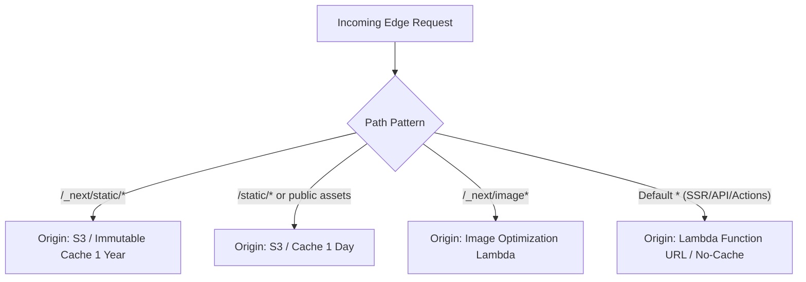

## Overview

Amazon CloudFront acts as the global CDN and entry point for all NextDeploy AWS serverless deployments.

NextDeploy provisions and manages the CloudFront distribution idempotently via `nextdeploy plan` and `nextdeploy ship`.

---

## Edge Routing Behaviors

A NextDeploy CloudFront distribution configures 4 optimized cache behaviors:



### 1. Static Assets (`/_next/static/*`)
- **Origin**: Private S3 bucket.
- **Cache Policy**: `Managed-CachingOptimized` (Query strings ignored, cookies stripped, Gzip and Brotli compression enabled).
- **TTL**: 31,536,000 seconds (1 year). All chunks are content-hashed by Next.js.

### 2. Public Directory Files (`/favicon.ico`, `/robots.txt`, `/images/*`)
- **Origin**: Private S3 bucket.
- **TTL**: Default 86,400 seconds (24 hours).

### 3. Image Optimization (`/_next/image*`)
- **Origin**: Image optimization Lambda function URL.
- **Cache Policy**: Keys on `url`, `w`, and `q` query parameters; forwards `Accept` header.

### 4. Dynamic SSR & API Routes (`*`)
- **Origin**: Next.js SSR Lambda function URL.
- **Cache Policy**: `Managed-CachingDisabled` (All query strings, cookies, and HTTP headers forwarded to Lambda).

---

## Origin Access Control (OAC)

NextDeploy uses modern **Origin Access Control (OAC)** rather than legacy Origin Access Identity (OAI):
- Direct SigV4 signing between CloudFront and S3.
- Completely blocks public access to the S3 bucket (`BlockPublicAcls`, `BlockPublicPolicy`, `IgnorePublicAcls`, `RestrictPublicBuckets`).
- Supports server-side encryption (SSE-KMS and SSE-S3).

---

## Custom Domains & Automated ACM Certificates

To bind your custom domain (e.g. `app.example.com`):

```yaml
app:
  domain:
    name: app.example.com
    zone_id: Z123456789EXAMPLE # Optional Route53 hosted zone
```

When a custom domain is configured:
1. NextDeploy automatically requests a public certificate in AWS Certificate Manager (ACM) in `us-east-1` (required by CloudFront).
2. If Route53 is used, NextDeploy creates the CNAME validation records automatically.
3. If external DNS (Cloudflare, GoDaddy, Namecheap) is used, NextDeploy prints the CNAME validation name and target in the terminal and waits for validation before cutover.
