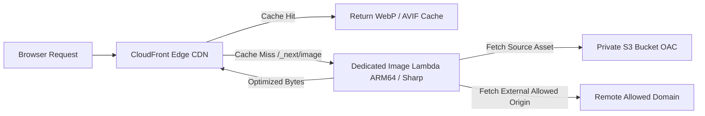

## Overview

In Next.js, the `<Image />` component delivers dynamically resized, modern format (WebP/AVIF) images via `/_next/image?url=...&w=...&q=...`.

When deploying to AWS, running image transcoding inside the primary Next.js SSR Lambda can cause severe CPU contention, memory bloat, and slow page response times. NextDeploy solves this by architecting a **dedicated image optimization architecture**:



---

## Dedicated Image Lambda Architecture

When `serverless.image_optimization: true` is configured in `nextdeploy.yml`:

1. **Independent Lambda Function**: NextDeploy provisions an isolated Lambda function (`<app>-image-optimizer`) configured specifically for CPU-intensive image resizing:
   - **Architecture**: `arm64` (AWS Graviton) for 20% lower cost and higher Sharp SIMD throughput.
   - **Memory**: 1536 MB (optimal balance between vCPU allocation and Lambda cost).
   - **Binary Engine**: Bundles precompiled Linux ARM64 libvips and Sharp binaries.
2. **Dedicated CloudFront Cache Behavior**:
   - Path Pattern: `/_next/image*`
   - Cache Policy: Keys on `url`, `w` (width), and `q` (quality) query parameters.
   - Origin Request Policy: Forwards `Accept` headers (`image/avif`, `image/webp`) so CloudFront caches format variants separately.
   - TTL: Default 30 days (`Cache-Control: public, max-age=2592000, immutable`).

---

## Configuration

Enable image optimization in `nextdeploy.yml`:

```yaml
target:
  type: serverless
  provider: aws

serverless:
  provider: aws
  region: us-east-1
  image_optimization: true # Deploys dedicated image optimizer Lambda
```

NextDeploy automatically inspects `next.config.{js,mjs,ts}` during compilation:

```javascript
// next.config.mjs
export default {
  images: {
    formats: ['image/avif', 'image/webp'],
    deviceSizes: [640, 750, 828, 1080, 1200, 1920, 2048],
    imageSizes: [16, 32, 48, 64, 96, 128, 256, 384],
    remotePatterns: [
      {
        protocol: 'https',
        hostname: 'images.unsplash.com',
      },
      {
        protocol: 'https',
        hostname: 'cdn.sanity.io',
      },
    ],
  },
};
```

---

## Security & SSRF Protection

NextDeploy enforces strict Server-Side Request Forgery (SSRF) defenses:
1. **Allowlisted Remote Hosts**: Only hostnames declared in `remotePatterns` or `domains` can be transcoded. External unallowlisted URLs return `400 Bad Request`.
2. **Private S3 Fetching**: Relative images (`/hero.png`) are fetched from your private S3 bucket using SigV4 credentials. The S3 bucket requires no public read access.
3. **Payload Clamping**: Width parameters are clamped to declared `deviceSizes` and `imageSizes` to prevent denial-of-service via arbitrary dimension generation.

---

## Cost Optimization & Unoptimized Fallback

For applications hosting static banners or offloading images to third-party CDNs (Cloudinary, Imgix):
```javascript
// next.config.mjs
export default {
  images: {
    unoptimized: true,
  },
};
```
Setting `unoptimized: true` instructs CloudFront to serve original assets directly from S3 without deploying or invoking the image optimization Lambda.
