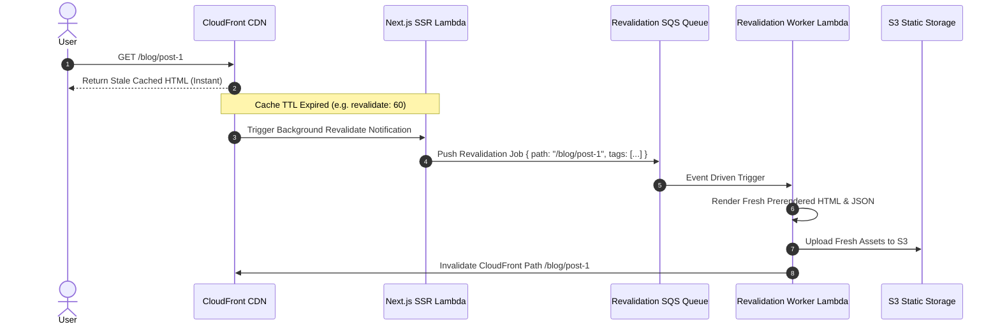

## Overview

Incremental Static Regeneration (ISR) allows Next.js applications to update static pages in the background without rebuilding the entire application.

In traditional serverless deployments, when a stale page revalidation triggers during a user request, the user's HTTP connection is blocked while the page re-renders. NextDeploy implements an **asynchronous decoupled ISR pipeline** using Amazon SQS:



---

## The Decoupled Architecture

When `serverless.isr_revalidation: true` is enabled in `nextdeploy.yml`:

1. **Amazon SQS Queue (`<app>-revalidation-queue`)**:
   - Manages asynchronous revalidation requests.
   - Configured with a Dead-Letter Queue (DLQ) to capture failed rendering jobs without dropping user requests.
2. **Dedicated Revalidation Worker Lambda (`<app>-revalidation-worker`)**:
   - Triggers automatically from SQS messages.
   - Invokes Next.js internal page renderer to compute the fresh HTML and RSC payload (`page.rsc`).
   - Writes the new rendered output to the application's S3 bucket.
3. **Automated Edge Invalidation**:
   - Upon successful S3 write, the worker sends an invalidation request to CloudFront for the specific path, ensuring global edge caches serve the updated page immediately.

---

## Configuration

Enable ISR in `nextdeploy.yml`:

```yaml
target:
  type: serverless
  provider: aws

serverless:
  provider: aws
  region: us-east-1
  isr_revalidation: true # Provisions SQS + Revalidation Worker
```

In your Next.js application routes:

```typescript
// app/blog/[slug]/page.tsx
export const revalidate = 60; // Revalidate at most once every 60 seconds

export default async function BlogPost({ params }: { params: { slug: string } }) {
  const post = await fetchPost(params.slug);
  return <article>{post.content}</article>;
}
```

### On-Demand Tag Revalidation (`revalidateTag`)

NextDeploy fully supports on-demand revalidation via Server Actions or API routes:

```typescript
// app/api/revalidate/route.ts
import { revalidateTag } from 'next/cache';
import { NextRequest, NextResponse } from 'next/server';

export async function POST(request: NextRequest) {
  const { tag, secret } = await request.json();
  if (secret !== process.env.REVALIDATION_SECRET) {
    return NextResponse.json({ message: 'Invalid token' }, { status: 401 });
  }

  // NextDeploy maps this tag to the SQS revalidation pipeline
  revalidateTag(tag);
  return NextResponse.json({ revalidated: true, now: Date.now() });
}
```

---

## Inspection & Observability

During `nextdeploy inspect` or `nextdeploy plan`, NextDeploy scans your build manifests and lists all detected ISR routes along with their revalidation intervals:

```
┌─ ISR ROUTE INVENTORY ──────────────────────────────────
│  /products/[id]   : revalidate=300s (tags: ['product'])
│  /blog/[slug]     : revalidate=60s
│  /leaderboard     : revalidate=10s
└────────────────────────────────────────────────────────
```
