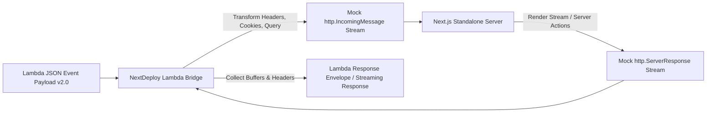

## Why a Bridge Adapter is Necessary

AWS Lambda does not natively speak standard HTTP; it receives JSON event payloads (such as API Gateway v2 HTTP API payload format or Lambda Function URL payload format) and expects a JSON response containing `statusCode`, `headers`, and a base64-encoded `body`.

Next.js standalone server, however, is a standard Node.js `http.Server` that expects native Node `http.IncomingMessage` and `http.ServerResponse` streams.

NextDeploy embeds a high-performance, zero-dependency **Lambda Bridge Adapter** directly into the server package.

---

## Architecture: Event-to-Stream Translation



---

## Key Features & Optimizations

### 1. Response Streaming & React 19 / RSC
For modern Next.js 15 and 16 applications utilizing React Server Components and `Suspense`, the bridge supports **AWS Lambda Response Streaming** (`awslambda.streamifyResponse`):
- HTML shells are flushed immediately to CloudFront.
- Suspense boundaries stream chunks down the wire as database promises resolve.
- Eliminates the 6MB Lambda payload limit for streamed SSR responses.

### 2. Multi-Value Headers & Set-Cookie Handling
A notorious flaw in serverless adapters is dropping multiple `Set-Cookie` headers. The NextDeploy bridge correctly translates multiple `Set-Cookie` headers into the API Gateway `cookies` array payload:
```json
{
  "cookies": [
    "session_id=abc; Path=/; Secure; HttpOnly",
    "theme=dark; Path=/; Max-Age=31536000"
  ]
}
```

### 3. Binary & Base64 Auto-Detection
The adapter inspects the outgoing `Content-Type` header. If binary data is detected (`image/*`, `application/octet-stream`, `font/*`, `application/pdf`), the payload is automatically base64-encoded with `isBase64Encoded: true`. Text and JSON payloads stream unencoded for minimal serialization overhead.

### 4. Cold-Start Optimization
The bridge initializes the Next.js request handler outside the Lambda handler function. During cold starts:
1. Environment variables and secrets from AWS Secrets Manager are loaded.
2. The Next.js routing tree and compiled server files are parsed once into memory.
3. Subsequent invocations reuse the warmed request handler instance, yielding warm invocation latencies under **15ms**.
