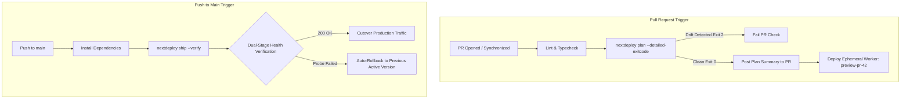

## Overview

NextDeploy includes native CI/CD generation via `nextdeploy generate-ci`. Unlike traditional boilerplate pipelines that require rewriting workflow YAML whenever you retarget an application, NextDeploy CI/CD pipelines use **runtime target resolution**:

- **Target-Agnostic Jobs**: The workflow inspects `nextdeploy.yml` on every run. If you switch from VPS to Cloudflare Workers or AWS, your existing CI/CD workflow adapts automatically without editing `.github/workflows/`.
- **Pre-Flight IaC Drift Detection**: Pull Requests trigger dry-run planning (`nextdeploy plan --detailed-exitcode`), exiting with code `2` if infrastructure drift or schema mismatches are detected.
- **Dual-Key VPS Security**: Production VPS deployments use host-key fingerprint pinning (`KNOWN_HOSTS`) combined with an ephemeral deployment key, preventing Man-in-the-Middle attacks.
- **Ephemeral PR Previews**: On Cloudflare Workers, pull requests automatically deploy isolated preview environments under `<app>-pr-<pr_number>.workers.dev` with deterministic cleanup.

---

## Generating CI/CD Workflows

### GitHub Actions
Generate a production-ready workflow file at `.github/workflows/nextdeploy.yml`:

```bash
# Generate workflow for default target
nextdeploy generate-ci --provider github

# Force overwrite of existing workflow
nextdeploy generate-ci --provider github --force

# Include ephemeral pull request preview deployments
nextdeploy generate-ci --provider github --preview
```

### GitLab CI
Generate `.gitlab-ci.yml`:

```bash
nextdeploy generate-ci --provider gitlab
```

---

## Workflow Architecture (GitHub Actions)



---

## Generated Workflow Structure

Below is an annotated breakdown of the generated `.github/workflows/nextdeploy.yml`:

```yaml
name: NextDeploy CI/CD

on:
  push:
    branches: [main]
  pull_request:
    branches: [main]

concurrency:
  group: ${{ github.workflow }}-${{ github.ref }}
  cancel-in-progress: true

jobs:
  # ─── 1. Pull Request Verification & Planning ───
  verify-and-plan:
    if: github.event_name == 'pull_request'
    runs-on: ubuntu-latest
    steps:
      - name: Checkout Code
        uses: actions/checkout@v4
        with:
          fetch-depth: 0 # Full history for git provenance tracking

      - name: Setup Go & Bun / Node
        uses: actions/setup-node@v4
        with:
          node-version: 20
          cache: 'npm'

      - name: Install NextDeploy CLI
        run: |
          curl -fsSL https://nextdeploy.org/install.sh | bash
          echo "$HOME/.local/bin" >> $GITHUB_PATH

      - name: Preflight Drift Check
        env:
          CLOUDFLARE_API_TOKEN: ${{ secrets.CLOUDFLARE_API_TOKEN }}
          CLOUDFLARE_ACCOUNT_ID: ${{ secrets.CLOUDFLARE_ACCOUNT_ID }}
          AWS_ACCESS_KEY_ID: ${{ secrets.AWS_ACCESS_KEY_ID }}
          AWS_SECRET_ACCESS_KEY: ${{ secrets.AWS_SECRET_ACCESS_KEY }}
        run: |
          # Exits 0 on clean plan, exits 2 on drift or pending infrastructure changes
          nextdeploy plan --detailed-exitcode

  # ─── 2. Production Deployment ───
  deploy-production:
    if: github.event_name == 'push' && github.ref == 'refs/heads/main'
    runs-on: ubuntu-latest
    steps:
      - name: Checkout Code
        uses: actions/checkout@v4

      - name: Install NextDeploy CLI
        run: |
          curl -fsSL https://nextdeploy.org/install.sh | bash
          echo "$HOME/.local/bin" >> $GITHUB_PATH

      - name: Configure SSH (VPS Target Only)
        run: |
          mkdir -p ~/.ssh
          echo "${{ secrets.SSH_PRIVATE_KEY }}" > ~/.ssh/id_rsa
          chmod 600 ~/.ssh/id_rsa
          echo "${{ secrets.SSH_KNOWN_HOSTS }}" >> ~/.ssh/known_hosts

      - name: Build, Ship & Verify
        env:
          CLOUDFLARE_API_TOKEN: ${{ secrets.CLOUDFLARE_API_TOKEN }}
          CLOUDFLARE_ACCOUNT_ID: ${{ secrets.CLOUDFLARE_ACCOUNT_ID }}
          AWS_ACCESS_KEY_ID: ${{ secrets.AWS_ACCESS_KEY_ID }}
          AWS_SECRET_ACCESS_KEY: ${{ secrets.AWS_SECRET_ACCESS_KEY }}
          NEXTDEPLOY_ENCRYPTION_KEY: ${{ secrets.NEXTDEPLOY_ENCRYPTION_KEY }}
        run: |
          nextdeploy ship --verify --verbose
```

---

## Required Secrets by Target

When you run `nextdeploy generate-ci`, the CLI prints the exact secrets required by your active target:

### For Cloudflare Workers
- `CLOUDFLARE_API_TOKEN`: Cloudflare API token with `Workers Scripts: Edit`, `Account Settings: Read`, and `R2 Storage: Edit`.
- `CLOUDFLARE_ACCOUNT_ID`: Your 32-character Cloudflare account identifier.
- `NEXTDEPLOY_ENCRYPTION_KEY`: (Optional) 32-byte hex key for encrypted state files.

### For Bare-Metal VPS
- `SSH_PRIVATE_KEY`: Private SSH key authorized in `/root/.ssh/authorized_keys` or `/home/deploy/.ssh/authorized_keys`.
- `SSH_KNOWN_HOSTS`: Output of `ssh-keyscan -H <your-server-ip>` for host-key pinning.

### For AWS Serverless
- `AWS_ACCESS_KEY_ID`: IAM user access key with Lambda, CloudFront, S3, and Secrets Manager permissions.
- `AWS_SECRET_ACCESS_KEY`: Matching IAM secret key.
- `AWS_REGION`: Target region (e.g. `us-east-1`).

---

## Ephemeral PR Previews

When `--preview` is enabled:
1. Every Pull Request creates an isolated environment:
   ```bash
   nextdeploy ship --environment pr-${{ github.event.pull_request.number }}
   ```
2. Cloudflare allocates an isolated worker: `my-app-pr-42.workers.dev`.
3. When the PR is merged or closed, NextDeploy tears down the preview worker and its bound R2 assets:
   ```bash
   nextdeploy destroy --environment pr-${{ github.event.pull_request.number }} --force
   ```
