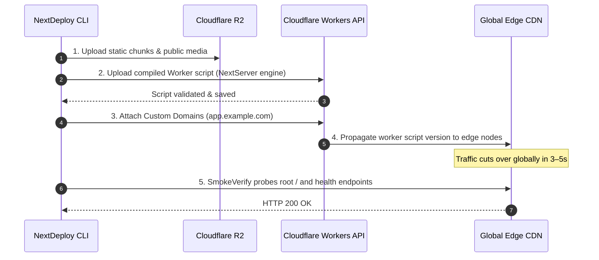

## Custom Domains vs. Legacy Routes

In early versions of Cloudflare Workers, traffic was attached using route patterns (e.g. `example.com/*`). Modern Cloudflare Workers utilize **Custom Domains**:
- **Automated DNS Record Provisioning:** Cloudflare automatically configures internal `AAAA 100::` routing records.
- **Automated SSL/TLS Management:** Dedicated edge certificates are issued, validated, and auto-renewed by Cloudflare.
- **Apex & Subdomain Parity:** Seamless support for both root domains (`example.com`) and subdomains (`app.example.com`).
- **No Route Pattern Conflicts:** Custom domains operate at the DNS routing layer, bypassing path-based wildcard routing conflicts.

NextDeploy manages Custom Domains declaratively inside `nextdeploy.yml`.

---

## Configuration in `nextdeploy.yml`

```yaml
target:
  type: serverless
  provider: cloudflare

serverless:
  cloudflare:
    account_id: ${CLOUDFLARE_ACCOUNT_ID}
    api_token: ${CLOUDFLARE_API_TOKEN}
    zone_name: example.com
    custom_domains:
      - hostname: app.example.com
        zone_name: example.com
      - hostname: example.com
        zone_name: example.com
```

---

## Zero-Downtime Deployment Lifecycle

When executing `nextdeploy ship`:



### The 5-Step Cutover Protocol:
1. **Permission Validation:** NextDeploy verifies that your API token has `Zone: Read`, `DNS: Edit`, and `Workers Scripts: Edit` permissions.
2. **Asset Pre-Upload:** Static assets are uploaded directly to Cloudflare R2 so edge caching is immediately primed.
3. **Worker Script Upload:** The compiled Next.js worker script bundle is uploaded and validated by Cloudflare's runtime validator.
4. **Domain Attachment:** NextDeploy binds the custom domains to the newly uploaded Worker version.
5. **Global Propagation & Smoke Verification:** Edge nodes route incoming HTTPS traffic to the new script within 3 to 5 seconds. NextDeploy performs automated `SmokeVerify` probes before signaling success.

---

## Handling Apex Domains & CNAME Flattening

When routing apex domains (`example.com`) on Cloudflare:
- Cloudflare DNS implements **CNAME Flattening** at the root zone automatically.
- No third-party DNS workarounds or ALIAS record hacks are necessary.
- If your root domain's DNS is hosted outside Cloudflare, you can delegate only a subdomain (`app.example.com`) to Cloudflare Workers Custom Domains using standard `CNAME` records.

---

## Verifying Propagation

```bash
# Verify worker custom domain resolution
dig app.example.com AAAA +short

# Test live response headers
curl -I https://app.example.com
```
Look for the `cf-ray` header and `server: cloudflare`, confirming that traffic is routed through Cloudflare's global edge network.
