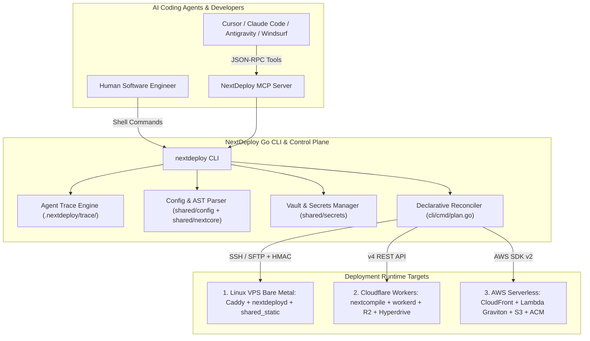

## Unified Control Plane, Three Specialized Runtimes

NextDeploy provides an agent-first, multi-target deployment engine for Next.js applications. A single declarative configuration file (`nextdeploy.yml`) controls application lifecycle across bare-metal Linux VPS hosts, Cloudflare Workers, and AWS Serverless.



---

## The Four Architectural Pillars

### 1. Bare-Metal Linux VPS Runtime
- **Reverse Proxy:** Caddy handles automatic Let's Encrypt TLS, HTTP/2, HTTP/3, and kernel NVMe `sendfile` static chunk delivery.
- **`nextdeployd` Systems Daemon:** High-performance static Go binary running under systemd with `DynamicUser=yes`, `ProtectSystem=strict`, and `cgroup v2` memory sandboxing.
- **Dual-Stage Health Probing:** Ephemeral loopback port allocation (`3001`, `3002`), TCP port listener verification, and HTTP GET `/api/health` validation before cutover.
- **Zero-Downtime Atomic Cutover:** Instant POSIX `renameat()` symlink swap (`current.tmp` → `current`) followed by Caddy live API hot-reloading (`localhost:2019/load`) and graceful 30-second connection draining.
- **Cumulative Static Chunk Pooling (`shared_static`):** Retains all historical content-hashed `/_next/static/*` chunks to permanently eliminate client-side `ChunkLoadError` 404 crashes during rolling deploys.
- **Optional Go Sidecar (`gosidecar`):** Sits between Caddy and Node.js to serve prerendered HTML/RSC payloads with sub-millisecond latencies and perform multi-threaded WebP/AVIF image transcoding.

### 2. Cloudflare Workers (`nextcompile` + `nextserver`)
- **Zero-Adapter Next.js 14/15/16:** Pure-Go compiler bundles standalone Next.js builds directly for Cloudflare `workerd` (`nodejs_compat_v2`).
- **Asset Separation & Offload:** Automatically uploads static assets (`.next/static/*` and `public/*`) to Cloudflare R2 with immutable 1-year caching headers (`Cache-Control: public, max-age=31536000, immutable`).
- **Edge Protection Guard:** Embedded IP CIDR whitelisting, KV rate limiting, and HMAC signature authentication before invocation.
- **Native Cloudflare Bindings:** Direct edge integration with D1 SQL databases, Hyperdrive connection pooling, Cloudflare Queues, KV, and Durable Objects.
- **Custom Domains:** Direct DNS cutover (`AAAA 100::`) and managed edge SSL certificates.

### 3. AWS Serverless Architecture
- **Lambda Function Runtime:** Packages Next.js standalone server into an AWS Lambda function running on Node.js 20.x on ARM64 Graviton with custom streaming HTTP bridge.
- **CloudFront & S3:** CloudFront CDN routes dynamic traffic to Lambda and static assets to a private S3 bucket secured with Origin Access Control (OAC).
- **Automated ACM SSL:** Free TLS certificate provisioning with automatic DNS validation CNAME records.
- **SQS-Backed ISR:** Asynchronous Incremental Static Regeneration cache invalidation queue.
- **Dedicated Image Optimizer:** Separate ARM64 Lambda function running Sharp for image resizing and WebP conversion.

### 4. Agent Trace & Handoff Continuity Layer
- **Persistent Agent Session Context:** Stored in `.nextdeploy/trace/`:
  - `checkpoint.json`: High-level agent intent, tasks, and file diffs.
  - `events.json`: Telemetry of CLI invocations, errors, and cutovers.
  - `takeover.md`: 20-line executive brief generated for human engineers.
- **Embedded Web Dashboard:** Local HTTP server running on `:4044` (`nextdeploy trace ui`) displaying live agent status, file diff viewer, and rollback buttons.
- **Human Takeover Protocol:** One-command handoff via `nextdeploy takeover -o` which outputs the brief and opens all modified files in `$EDITOR`.
- **Model Context Protocol (MCP) Server:** Native `nextdeploy-mcp` exposing 10 structured tools (`nextdeploy_plan`, `nextdeploy_ship`, `nextdeploy_trace_checkpoint`, etc.) for Cursor, Claude Code, and Antigravity IDE.

---

## Directory Organization

```text
NextDeploy/
├── cli/                   # NextDeploy CLI entrypoint & subcommands (Cobra)
│   ├── cmd/               # plan, ship, trace, takeover, status, rollback
│   └── internal/          # Serverless, VPS, and DNS orchestrators
├── daemon/                # nextdeployd Linux systems daemon
│   └── cmd/nextdeployd/   # Standalone Go daemon binary for Linux VPS
├── shared/                # Core shared Go packages
│   ├── agenttrace/        # Native Agent Trace engine & Web UI (:4044)
│   ├── config/            # nextdeploy.yml parser & validator
│   ├── nextcompile/       # Cloudflare NextServer bundler & runtime JS shims
│   └── secrets/           # AES-256-GCM encryption & Doppler bridge
├── frontend/              # Next.js 16 (Turbopack) documentation & web app
│   ├── content/docs/      # 65+ technical guides and references
│   └── public/            # llms.txt and llms-full.txt specification files
└── magefile.go            # Cross-platform Mage build script
```
