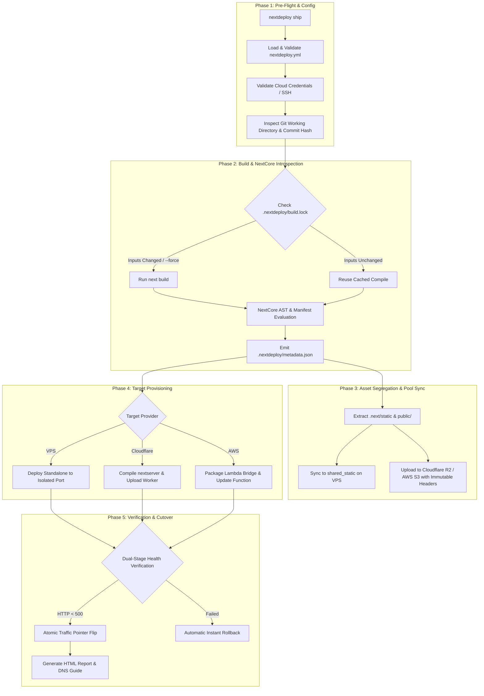

## Build-Time Intelligence, Not Blind File Copying

Most self-hosted deployment tools and Docker scripts treat Next.js as an opaque black box: they copy the entire repository into a container, run `npm install`, compile on the production server, and restart the process.

This legacy approach causes major issues:
- Build tools (compilers, devDependencies) bloat production images to 1.5GB+.
- Memory spikes during `next build` crash resource-constrained $4/month VPS nodes.
- Inactive routes and unneeded server code remain bundled.
- Active browser sessions experience `ChunkLoadError` 404s during deployment.

**NextDeploy is fundamentally different.** It acts as an **intelligent compilation and deployment orchestrator**. It parses your Next.js build output once on your local machine or CI/CD runner, extracts every route, dependency, and static asset, and uses that static intelligence to drive zero-downtime deployments.

---

## The 5-Phase Deployment Pipeline

---

## Phase 1: Pre-Flight Configuration & Validation

NextDeploy loads `nextdeploy.yml` and resolves environment variable interpolations (`${DATABASE_URL}`, `${CLOUDFLARE_API_TOKEN}`).

Before executing any builds:
1. **Target Pre-Flight**: Validates target credentials (SSH connectivity for VPS; token permissions for Cloudflare; IAM policies for AWS).
2. **Git Provenance Capture**: Captures the current commit hash, branch, author, and dirty state. If uncommitted changes exist, NextDeploy issues a warning and records the dirty state in the deployment audit trail.

---

## Phase 2: Incremental Build Reuse & NextCore Introspection

NextDeploy tracks compilation inputs in `.nextdeploy/build.lock`:
- Package manager lockfile (`pnpm-lock.yaml`, `package-lock.json`, `bun.lock`).
- `next.config.{js,mjs,ts}` and `tsconfig.json`.
- Environment variable hashes.

If none of these files have changed since the last build, NextDeploy **skips `next build` entirely**, saving 1 to 3 minutes per deployment run.

### NextCore Introspection Engine
NextDeploy's `shared/nextcore` package parses the `.next/` directory:
- **Route Manifests**: Parses `pages-manifest.json` and `app-paths-manifest.json` to categorize every route into:
  - `Static`: Pre-rendered HTML (`/about`, `/pricing`).
  - `SSG / ISR`: Pre-rendered pages with revalidation intervals (`revalidate: 60`).
  - `SSR`: Dynamic server-rendered pages (`/dashboard`, `/profile`).
  - `Server Actions`: Extracted action IDs (`__next_action_id`) for RPC routing.
  - `Middleware & Proxies`: Extracted route matchers, `has`/`missing` conditions, and headers.
- **External Integration Detection**: Scans compiled server chunks for Stripe, Prisma, Supabase, Cloudinary, and Analytics SDKs to ensure required secrets exist before deploying.

---

## Phase 3: Asset Segregation & Static Pool Sync

Framework assets (`.next/static/*`) and static media (`public/*`) are decoupled from server compute:
- **For VPS Targets**: Assets are copied into `/opt/nextdeploy/apps/<app>/shared_static/`. Historical chunks are permanently retained across deployments, eliminating `ChunkLoadError` 404s for active browser sessions.
- **For Cloudflare & AWS Targets**: Assets are uploaded in parallel to Cloudflare R2 or Amazon S3 with immutable 1-year caching headers (`Cache-Control: public, max-age=31536000, immutable`). Serverless execution bundles remain ultra-compact (typically under 25MB).

---

## Phase 4: Target-Specific Compute Provisioning

- **VPS Target**: The `nextdeployd` Go daemon unpacks the standalone application into a fresh directory (`releases/<timestamp>`), arbitrates an available internal port (e.g. `3002`), and starts the service under systemd with `cgroup v2` memory capping.
- **Cloudflare Workers Target**: The `nextcompile` compiler bundles the standalone server with virtual file system (VFS) shims, binds declared D1, Hyperdrive, Queues, and R2 resources, and uploads the worker script via the Cloudflare API.
- **AWS Serverless Target**: Packages compute into an ARM64 Lambda function, mounts the AWS Secrets Manager extension, updates CloudFront edge routing, and provisions SQS ISR queues.

---

## Phase 5: Verification, Atomic Cutover & Self-Healing

NextDeploy never routes production traffic to an unverified deployment:
1. **Dual-Stage Health Verification**:
   - **Stage 1 (TCP Verification)**: Verifies the application process has bound to its assigned port and is accepting TCP connections.
   - **Stage 2 (HTTP Smoke Verification)**: Sends HTTP GET requests to `/api/health` and critical pre-rendered routes, verifying HTTP status 200.
2. **Atomic Traffic Cutover**:
   - On **VPS**: Atomically replaces the `current` symlink using the POSIX `rename()` syscall. Caddy reloads configuration with zero dropped connections.
   - On **Cloudflare**: Updates the Custom Domain or route worker pointer globally in 3 to 5 seconds.
   - On **AWS**: Publishes a new Lambda function alias and shifts CloudFront origin traffic.
3. **Self-Healing Rollback**: If health checks fail or an unhandled exception occurs on boot, NextDeploy halts cutover, preserves the previous active version, extracts the runtime stack trace, and rolls back instantly.
