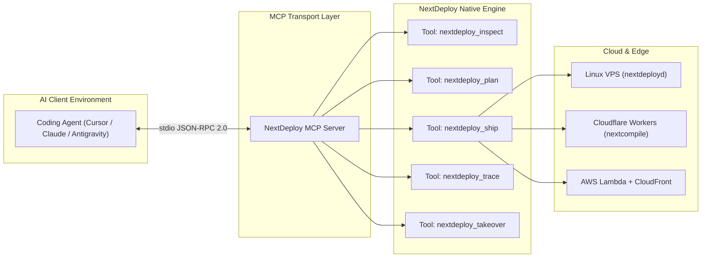

## What is MCP?

The **Model Context Protocol (MCP)** is an open standard that enables AI models and autonomous coding agents (Claude Desktop, Cursor, Antigravity IDE, Windsurf, Roo Code, Goose) to securely connect to external tools, databases, and infrastructure.

Instead of requiring an LLM to guess CLI arguments or scrape terminal ANSI colors using raw bash subshells, an MCP server provides **strongly-typed, schema-validated tool definitions**.

NextDeploy runs natively as an MCP server via:
```bash
nextdeploy mcp
```

### Auto-Scaffolding MCP Client Configs
NextDeploy can automatically generate the correct MCP JSON configuration files for your editor:

```bash
# Configure Cursor (.cursor/mcp.json)
nextdeploy mcp init --client cursor

# Configure Google Antigravity IDE (.antigravity/mcp_servers.json)
nextdeploy mcp init --client antigravity

# Configure all supported environments
nextdeploy mcp init --client all
```

---

## Architecture: Agent to NextDeploy over MCP



---

## Client Configuration

### 1. Cursor IDE (`.cursor/mcp.json`)
In your project root, create `.cursor/mcp.json`:

```json
{
  "mcpServers": {
    "nextdeploy": {
      "command": "nextdeploy",
      "args": ["mcp"],
      "env": {
        "PATH": "/usr/local/bin:/opt/homebrew/bin:~/.local/bin:$PATH"
      }
    }
  }
}
```

### 2. Claude Desktop (`claude_desktop_config.json`)
On macOS: `~/Library/Application Support/Claude/claude_desktop_config.json`:

```json
{
  "mcpServers": {
    "nextdeploy": {
      "command": "nextdeploy",
      "args": ["mcp"],
      "env": {
        "CLOUDFLARE_API_TOKEN": "your-token-here",
        "CLOUDFLARE_ACCOUNT_ID": "your-account-id-here"
      }
    }
  }
}
```

### 3. Google Antigravity IDE
In `.antigravity/mcp_servers.json`:

```json
{
  "mcpServers": {
    "nextdeploy": {
      "command": "nextdeploy",
      "args": ["mcp"]
    }
  }
}
```

---

## Why MCP Outperforms Raw Bash Execution

| Capability | Raw Bash Subshell (`run_command`) | NextDeploy Native MCP |
| :--- | :--- | :--- |
| **Parameter Validation** | None (prone to syntax errors, shell escaping bugs) | Strongly-typed JSON schema validation |
| **Interactive Prompts** | Hangs headless agent processes indefinitely | Fully non-interactive by protocol design |
| **Error Handling** | Unstructured regex scraping of ANSI terminal output | Structured JSON error envelopes with `culprit_file` and `fix_hint` |
| **Security** | Arbitrary shell execution risk | Scoped, permission-gated infrastructure operations |
| **Context Consumption** | 2,000 lines of terminal logs consuming tokens | Concise structured telemetry responses |
