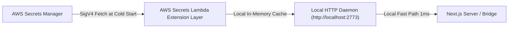

## The Plaintext Environment Variable Vulnerability

A common security anti-pattern in serverless architectures is setting secrets directly in Lambda environment variables (`process.env.DATABASE_URL`).

This exposes sensitive credentials in multiple attack surfaces:
- Plaintext visibility in the AWS Management Console to anyone with read-only IAM permissions.
- Inadvertent logging in AWS CloudTrail API event histories (`GetFunction`, `UpdateFunctionConfiguration`).
- Permanent preservation across all published immutable Lambda version snapshots.

NextDeploy mitigates this vulnerability by utilizing the **AWS Parameters and Secrets Lambda Extension**.

---

## Extension Architecture



---

## How It Works

1. **Automated Layer Mounting**: When `serverless.provider: aws` is deployed, NextDeploy automatically attaches the AWS-managed Secrets Manager Extension ARN matching your architecture (`arm64` or `x86_64`) and region.
2. **Local HTTP Daemon**: The extension runs as an independent companion process inside the Lambda execution environment, listening on `http://localhost:2773`.
3. **In-Memory Caching**: During cold start, the NextDeploy bridge fetches all application secrets via a local loopback HTTP call (`GET http://localhost:2773/systemsmanager/parameters/get/?name=...`). The extension caches secrets in memory for the lifetime of the Lambda instance.
4. **Zero Outbound Latency During Warm Invocations**: After cold start, subsequent user requests read from memory with **0ms outbound network latency**.

---

## Configuration

In `nextdeploy.yml`:

```yaml
target:
  type: serverless
  provider: aws

serverless:
  provider: aws
  region: us-east-1
  kms_key_id: "alias/production-secrets-key" # Optional custom customer KMS key
  allow_secrets_in_env: false # Defaults to false for strict security
```

> [!WARNING]
> Only set `allow_secrets_in_env: true` if your deployment IAM role lacks `lambda:GetLayerVersion` permissions and you explicitly accept that secrets will be persisted in published Lambda versions.
