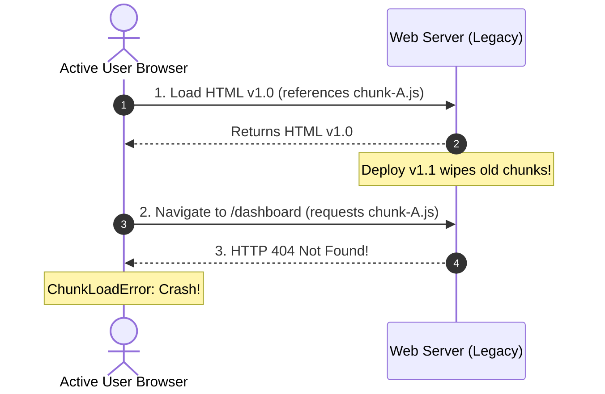
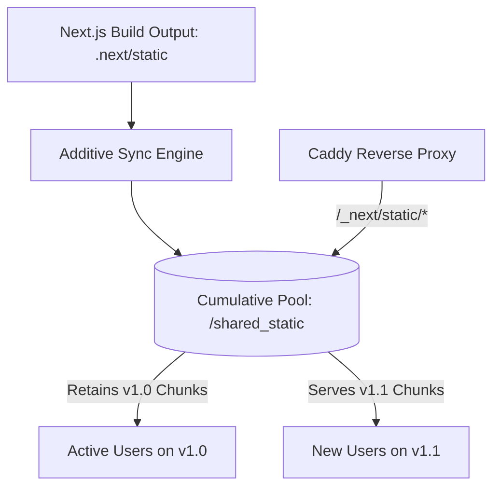

## The Client-Side `ChunkLoadError` Problem

Next.js utilizes aggressive code-splitting. Every page, component, and dynamic import is compiled into an immutable, content-hashed JavaScript chunk:
- `_next/static/chunks/app/dashboard-8f92a1.js`
- `_next/static/chunks/684-2a1d9e.js`

In traditional deployment pipelines (or naïve Docker container replacements):
1. User A visits your Next.js application at version `v1.0`. The HTML shell is loaded into their browser, referencing chunk `dashboard-8f92a1.js`.
2. While User A is reading the page, you deploy `v1.1`. The new deployment deletes or replaces the previous `.next/static` directory with fresh chunks (`dashboard-3c4b5e.js`).
3. User A clicks the "Dashboard" navigation tab. Their browser requests the old chunk:
   ```text
   GET /_next/static/chunks/app/dashboard-8f92a1.js HTTP/2
   ```
4. The server cannot find the file and returns **HTTP 404 Not Found**.
5. The application crashes in User A's browser with the unhandled runtime error:
   ```text
   ChunkLoadError: Loading chunk app/dashboard-8f92a1 failed.
   (missing: https://example.com/_next/static/chunks/app/dashboard-8f92a1.js)
   ```



---

## How NextDeploy Solves It: `shared_static`

NextDeploy permanently eliminates this issue on VPS bare metal by implementing a **Cumulative Static Chunk Pool**:

```text
/opt/nextdeploy/apps/<app>/
├── current -> releases/v1.1/
├── releases/
│   ├── v1.0/
│   └── v1.1/
└── shared_static/               <── Cumulative Static Chunk Pool
    ├── chunks/
    │   ├── app/dashboard-8f92a1.js   (Retained from v1.0)
    │   └── app/dashboard-3c4b5e.js   (Added in v1.1)
    ├── media/
    └── css/
```

---

## The Synchronization Protocol

1. **Build Phase:** Next.js compiles the application, creating hashed assets in `.next/static/`.
2. **Transfer Phase:** The release archive is unpacked into `/opt/nextdeploy/apps/<app>/releases/<new-id>/`.
3. **Cumulative Pooling (`nextdeployd`):** The daemon copies all files from `.next/static/` into `/opt/nextdeploy/apps/<app>/shared_static/` using an additive synchronization algorithm (`rsync --ignore-existing` semantics):
   - Existing chunks are **never deleted or overwritten**.
   - Because chunks are content-hashed, identical files share the exact same hash, while modified components receive new unique hashes.
4. **Caddy Static Routing:** Caddy serves all requests matching `/_next/static/*` directly from `/opt/nextdeploy/apps/<app>/shared_static/` using high-speed Linux kernel `sendfile`.
5. **Zero 404s:** Active users who opened the site before deployment continue navigating seamlessly across pages.



---

## Historical Retention & Ring Buffer Garbage Collection

To ensure disk usage remains bounded, `nextdeployd` maintains an immutable ring buffer of the 5 most recent releases in `/opt/nextdeploy/apps/<app>/releases/`. Older release directories are automatically retired and cleaned up during atomic cutover, while active chunks in `shared_static` remain available to avoid missing chunk 404s.
