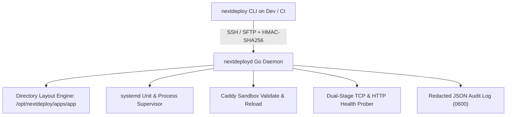

## Systems Architecture of `nextdeployd`

`nextdeployd` is a lightweight, statically linked Go binary compiled with zero external C-library dependencies. It runs as a persistent systemd service on your managed Linux host (`/usr/local/bin/nextdeployd`).

Unlike heavyweight orchestration systems (Kubernetes Kubelet, Nomad, Docker Daemon), `nextdeployd` consumes **under 12 MB of RAM** at idle and communicates with the `nextdeploy` CLI via an encrypted SSH channel or authenticated mTLS Unix socket.



---

## Daemon Responsibilities & Lifecycle

### 1. Release Ingestion & SHA256 Verification
When `nextdeploy ship` transmits a new release archive:
- The daemon unpacks the tarball into `/opt/nextdeploy/apps/<app>/releases/<timestamp>/`.
- Computes and verifies SHA256 integrity checksums against the manifest.
- Copies fresh static JavaScript chunks into `/opt/nextdeploy/apps/<app>/shared_static/`.

### 2. Dynamic Port Arbitration
- Inspects active listening ports starting from base port `3000`.
- Assigns an available loopback port (e.g. `3001`, `3002`) to the incoming release.
- Generates an isolated `.env.production` containing `PORT=3002` and runtime variables.

### 3. Dual-Stage Health Verification
Before cutting over any traffic:
- **Stage 1 (TCP Socket Listener):** Polls the assigned loopback port until the Node.js server actively binds and accepts incoming TCP connections.
- **Stage 2 (HTTP Health Probe):** Issues HTTP GET requests to `http://127.0.0.1:3002/api/health` verifying HTTP 200 OK within the configured timeout window.

### 4. Atomic Cutover Execution
- Issues an atomic POSIX symlink swap (`rename()`) pointing `/opt/nextdeploy/apps/<app>/current` to the new release directory.
- Sends an updated upstream configuration JSON to Caddy's live admin API (`http://127.0.0.1:2019/load`).
- Caddy hot-swaps traffic routing instantly (<2ms) without dropping active TCP connections.

### 5. Historical Retention & Ring Buffer Garbage Collection
- Maintains an immutable ring buffer of the 5 most recent releases.
- Older releases are automatically pruned to prevent disk bloat, while `shared_static` chunks are preserved.

---

## systemd Unit Configuration (`nextdeployd.service`)

The daemon runs under systemd with automatic restart on failure:

```ini
[Unit]
Description=NextDeploy Systems Host Daemon
After=network.target caddy.service
Requires=caddy.service

[Service]
Type=simple
User=root
ExecStart=/usr/local/bin/nextdeployd --foreground=true
Restart=always
RestartSec=5s
LimitNOFILE=65536
StandardOutput=journal
StandardError=journal

[Install]
WantedBy=multi-user.target
```

---

## Daemon Hot-Upgrade Protocol (`nextdeploy upgrade-daemon`)

To upgrade `nextdeployd` on your remote Linux VPS to match your local CLI version without restarting active Next.js user applications:

```bash
nextdeploy upgrade-daemon
```

### Upgrade Execution Steps:
1. CLI uploads the new static binary to `/usr/local/bin/nextdeployd.new`.
2. Verifies cryptographic signature and file permissions.
3. Performs an atomic swap: `mv /usr/local/bin/nextdeployd.new /usr/local/bin/nextdeployd`.
4. Executes `systemctl restart nextdeployd`.
5. Active Next.js processes and Caddy proxy routing continue running with zero downtime.
