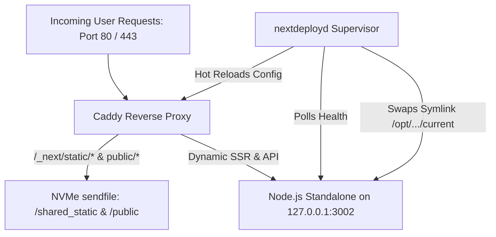

## Why Bare-Metal Linux VPS

Running Next.js directly on a $4–$20/month Linux VPS (Hetzner, DigitalOcean, Linode, OVH, or AWS EC2) eliminates Docker daemon overhead, container networking bottlenecks, cold starts, and per-invocation serverless billing — while keeping complete developer simplicity:

1. **Caddy Reverse Proxy:** Automatic Let's Encrypt TLS, HTTP/2 & HTTP/3, and direct NVMe `sendfile` delivery of `/_next/static/*` and `public/*`.
2. **`nextdeployd` Daemon:** Lightweight Go systems agent managing release directories, systemd units, dual-stage TCP + HTTP health probes, atomic symlink swaps, and instant rollbacks.
3. **Cumulative Chunk Pooling (`shared_static`):** Prevents `ChunkLoadError` 404 crashes for active browser tabs across releases.
4. **Optional Go Sidecar (`gosidecar`):** Sub-millisecond prerendered HTML/RSC serving and multi-threaded Go WebP/AVIF image transcoding ahead of Node.js.
5. **Kernel `cgroup v2` Isolation:** Hard memory and CPU limits per application prevent noisy neighbor issues.

---

## Target Architecture Layout



---

## Directory Layout on the Host Server

NextDeploy organizes applications under `/opt/nextdeploy/apps/<app-name>/` (or configured base path):

```text
/opt/nextdeploy/apps/<app-name>/
├── current -> releases/2026-11-23_14-20-00/   # Atomically swapped symlink
├── releases/
│   ├── 2026-11-23_10-15-00/                   # Retained release n-1 (Instant rollback)
│   ├── 2026-11-23_12-30-00/                   # Retained release n
│   └── 2026-11-23_14-20-00/                   # Current active release
│       ├── .next/standalone/server.js
│       ├── .env.production
│       └── package.json
└── shared_static/                             # Cumulative pool of content-hashed JS chunks
    └── chunks/
        ├── app/layout-1a2b3c.js
        └── pages/index-4d5e6f.js
```

---

## Core Operational Commands

```bash
# 1. Bootstrap fresh server (installs Caddy, nextdeployd, configures systemd)
nextdeploy prepare

# 2. Dry run preview of planned changes and disk allocation
nextdeploy plan

# 3. Build locally, sync assets, execute health checks, and cut over
nextdeploy ship

# 4. View real-time service status, memory/CPU usage, active release
nextdeploy status

# 5. Tail live logs across application and reverse proxy
nextdeploy logs

# 6. Instant zero-downtime rollback to previous release (<10ms)
nextdeploy rollback

# 7. Hot-upgrade remote nextdeployd daemon to match CLI version
nextdeploy upgrade-daemon
```

---

## Security & Sandboxing

On VPS targets, NextDeploy configures systemd services with strict Linux kernel sandboxing:
- `ProtectSystem=strict`: Root filesystem is mounted read-only for the application process.
- `ProtectHome=true`: `/home` and `/root` are inaccessible to the Node.js process.
- `PrivateTmp=true`: Isolated `/tmp` namespace prevents inter-process inspection.
- `MemoryMax=1024M`: Enforced by `cgroup v2` to prevent memory leaks from starving system services.
