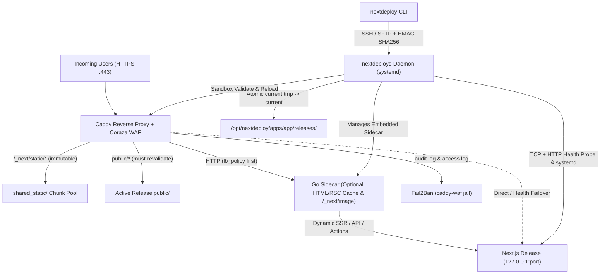

## Why Bare-Metal Linux VPS

Running Next.js directly on a $4–$20/month Linux VPS (Hetzner, DigitalOcean, Linode, OVH, or AWS EC2) eliminates Docker daemon overhead, container networking bottlenecks, cold starts, and per-invocation serverless billing — while keeping complete developer simplicity:

1. **Caddy Reverse Proxy:** Automatic Let's Encrypt TLS, HTTP/2 & HTTP/3, and direct NVMe `sendfile` delivery of `/_next/static/*` and `public/*`.
2. **`nextdeployd` Daemon:** Lightweight Go systems agent managing release directories, systemd units, dual-stage TCP + HTTP health probes, atomic symlink swaps, and instant rollbacks.
3. **Cumulative Chunk Pooling (`shared_static`):** Prevents `ChunkLoadError` 404 crashes for active browser tabs across releases.
4. **Optional Go Sidecar (`gosidecar`):** Sub-millisecond prerendered HTML/RSC serving and multi-threaded Go WebP/AVIF image transcoding ahead of Node.js.
5. **Kernel `cgroup v2` Isolation:** Hard memory and CPU limits per application prevent noisy neighbor issues.

---

## Host & Access Requirements

Before running `nextdeploy prepare` or `nextdeploy ship` on a VPS, ensure you have:

1. **Ubuntu/Debian Linux VPS:** Public IPv4 with ports `22` (SSH), `80` (HTTP/ACME), and `443` (HTTPS) open.
2. **Non-root `sudo` user:** A non-root SSH user (e.g. `deploy` or `ubuntu`) with `sudo` privileges (`nextdeploy prepare` refuses `root` by default).
3. **SSH private key path:** A local SSH private key (`~/.ssh/id_ed25519`, `chmod 600`) configured as `key_path` in `nextdeploy.yml` with its public key installed in the remote user's `~/.ssh/authorized_keys`.
4. **Domain DNS:** An `A` record pointing your domain to the VPS IPv4 address so Caddy can provision Let's Encrypt TLS certificates.
5. **Secrets synchronization:** Sync full-stack runtime secrets via **Doppler (recommended)** (`doppler run -- nextdeploy secrets sync`) or **`.env`** (`nextdeploy secrets load .env.production && nextdeploy secrets sync`).

See the [Requirements Guide](/docs/getting-started/requirements) for setup commands.

---

## Target Architecture Layout



---

## Directory Layout on the Host Server

NextDeploy organizes applications under `/opt/nextdeploy/apps/<app-name>/`:

```text
/opt/nextdeploy/apps/<app-name>/
├── current -> releases/1763890000-a1b2c3d/   # Atomically swapped POSIX symlink
├── port                                       # Persisted active loopback port
├── releases/
│   ├── 1763880000-9f8e7d6/                    # Retained release n-1 (instant rollback)
│   └── 1763890000-a1b2c3d/                    # Current active release ({unix-ts}-{shortSha})
│       ├── .next/standalone/server.js
│       ├── .env.nextdeploy                      # Rendered secrets (0600, nextdeploy:nextdeploy)
│       └── .nextdeploy/
│           ├── metadata.json
│           └── node.port
└── shared_static/                             # Cumulative pool of content-hashed JS/CSS chunks
    └── chunks/
        ├── app/layout-1a2b3c.js
        └── pages/index-4d5e6f.js
```

---

## Core Operational Commands

```bash
# 1. Bootstrap fresh server (installs Caddy, nextdeployd, configures systemd)
nextdeploy prepare

# 2. Dry run preview of planned changes and disk allocation
nextdeploy plan

# 3. Build locally, sync assets, execute health checks, and cut over
nextdeploy ship

# 4. View real-time service status, memory/CPU usage, active release
nextdeploy status

# 5. Tail live logs across application and reverse proxy
nextdeploy logs

# 6. Instant zero-downtime rollback to previous release (<10ms)
nextdeploy rollback

# 7. Hot-upgrade remote nextdeployd daemon to match CLI version
nextdeploy upgrade-daemon
```

---

## Security & Sandboxing

On VPS targets, NextDeploy configures systemd services with strict Linux kernel sandboxing:
- `User=nextdeploy` / `Group=nextdeploy`: Dedicated unprivileged system account (`--shell /sbin/nologin`) with `ReadWritePaths` scoped to the release directory.
- `ProtectSystem=strict`: Root filesystem is mounted read-only for the application process.
- `ProtectHome=yes`: `/home` and `/root` are inaccessible to the Node.js process.
- `PrivateTmp=yes` & `NoNewPrivileges=yes`: Isolated `/tmp` namespace and blocked privilege escalation.
- Opt-in `cgroup v2` limits (`MemoryMax`, `MemoryHigh`, `CPUQuota`): Configured via `app.resources` in `nextdeploy.yml`.
