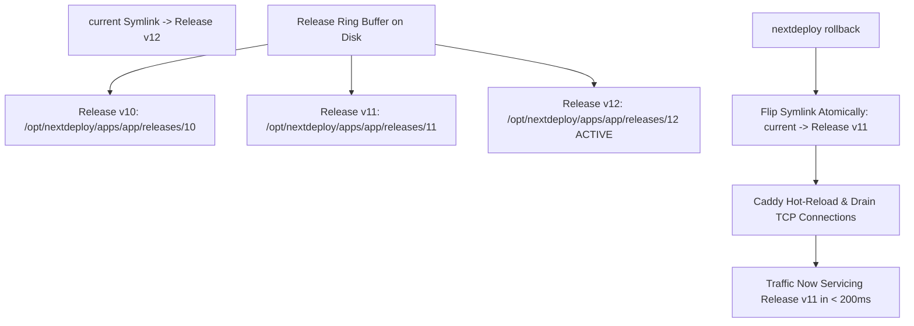

## Overview

When an unexpected regression or runtime crash occurs in production, rebuilding and redeploying can take minutes. 

On Linux VPS targets, NextDeploy executes rollbacks in **under 200 milliseconds** by maintaining a **5-release ring buffer** and flipping the active directory symlink atomically.



---

## The Release Ring Buffer

Every successful `nextdeploy ship` installs the deployment into a unique, timestamped release directory on the VPS:

```
/opt/nextdeploy/apps/<app>/
├── current -> releases/20261123_142010 (Active POSIX Symlink)
├── releases/
│   ├── 20261123_110500  (Release v10)
│   ├── 20261123_121530  (Release v11)
│   ├── 20261123_133045  (Release v12 - Previous Stable)
│   └── 20261123_142010  (Release v13 - Current Active)
└── shared_static/       (Cumulative pooled Next.js JS chunks)
```

- **Ring Buffer Retention**: The `nextdeployd` daemon preserves the last 5 successful release directories.
- **Automated Pruning**: Older releases beyond the retention window are cleanly pruned from disk, while their static JS chunks remain preserved in `shared_static` to protect active browser sessions.

---

## Executing Rollbacks

### 1. Roll Back to Immediately Preceding Release
```bash
nextdeploy rollback
```

### 2. Roll Back Multiple Versions
```bash
# Roll back 2 releases back
nextdeploy rollback --steps 2
```

### 3. Roll Back to a Specific Release ID
```bash
nextdeploy rollback --release 20261123_121530
```

---

## Rollback Lifecycle & Safety Guarantees

When `nextdeploy rollback` is triggered:
1. **Target Inspection**: The CLI queries `nextdeployd` for the active release history.
2. **Health Verification**: Before traffic cutover, the target release process is started on an isolated port and probed (`GET /api/health`).
3. **Atomic Symlink Flip**: `nextdeployd` creates a temporary symlink (`current.tmp`) pointing to the target release and renames it over `current` using the atomic POSIX `rename()` syscall.
4. **Zero Dropped Packets**: Caddy's dynamic upstream reloader gracefully finishes in-flight requests on the old process before routing new TCP connections to the rolled-back version.
